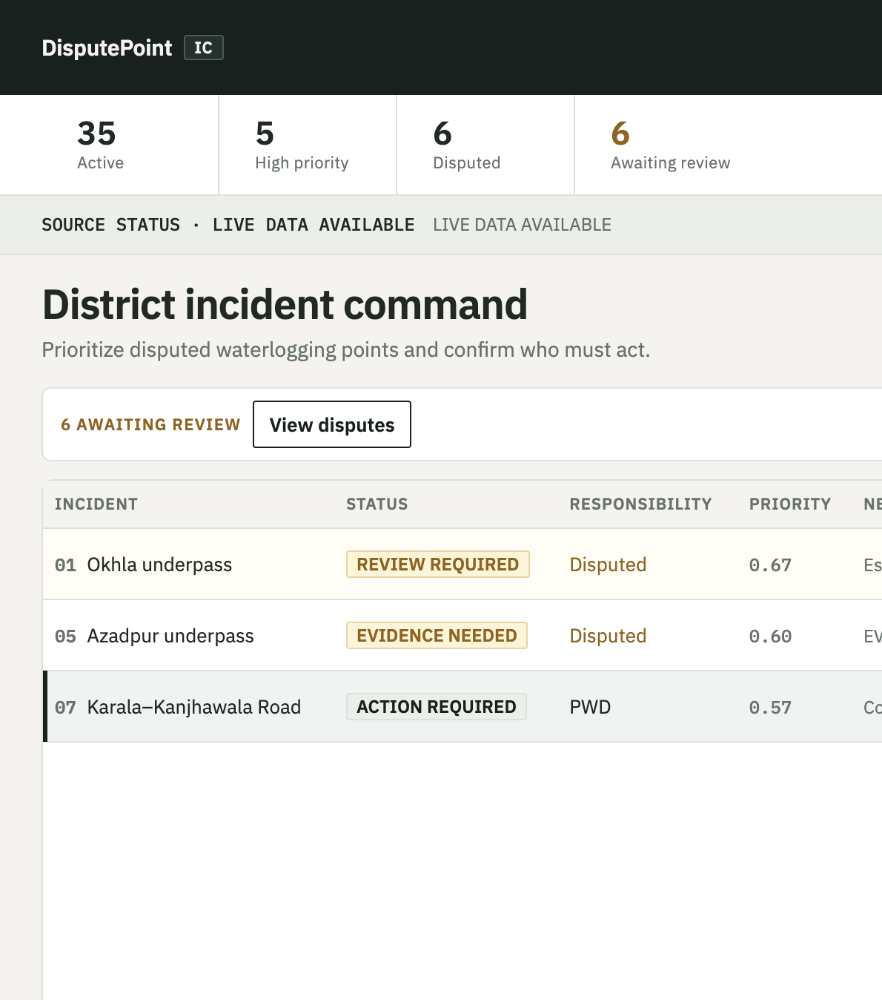

# DisputePoint Response Intelligence

**When a road floods, getting the right response started should not depend on guessing who is responsible.**

Heavy monsoon rain can strand commuters, disrupt daily life, and repeatedly waterlog the same locations across Delhi. Responding to an incident means more than identifying where water has accumulated. Teams must review the available evidence, establish responsibility where possible, and coordinate what happens next.

DisputePoint is an incident-coordination system designed to help response teams prioritize reported waterlogging incidents, examine competing agency claims, and record responsibility decisions.

When responsibility is clear, the system displays the assigned agency. When claims conflict, it keeps responsibility unresolved until an authorized officer reviews the evidence.

**Not just where the problem is. What needs attention, what is known, and what happens next.**

**Built for [WeMakeDevs × AWS Environmental Hacks](https://www.wemakedevs.org/aws/env).**

[Live Demo](http://disputepoint-uibucket-nuoadlgtpdko.s3-website.ap-south-1.amazonaws.com)
· [AWS Architecture](http://disputepoint-uibucket-nuoadlgtpdko.s3-website.ap-south-1.amazonaws.com/aws-arch.html)
· [Demo Video](#demo-video)



*Live queue of Delhi waterlogging places. Assigned, disputed, and evidence-needed states stay distinct — the system does not invent an owner when claims conflict.*

---

## Why this matters

Waterlogging disrupts commutes, damages vehicles, and makes some roads difficult to cross. Residents have described recurring flooding and dissatisfaction with monsoon preparedness. A July 2025 LocalCircles survey documented lost productive time and poor preparedness ratings among its Delhi-NCR respondents — figures describe that survey’s respondents, not every resident of Delhi ([LocalCircles](https://www.localcircles.com/a/press/page/gurugram-water-logging)). Reporting from the same monsoon season described standstill traffic and waterlogged underpasses and lanes ([Hindustan Times](https://www.hindustantimes.com/cities/delhi-news/delhi-buckles-under-first-significant-monsoon-rain-spell-101752171973612.html)).

Delhi’s High Court has also highlighted confusion among civic agencies over drainage responsibilities ([TOI](https://timesofindia.indiatimes.com/india/much-confusion-on-who-does-what-even-upkeep-of-drains-hc-to-delhi-government/articleshow/122963747.cms)). That supports the existence of a coordination problem; it does not endorse this product.

**DisputePoint focuses on one part of the response:** helping teams coordinate incidents when responsibility is unclear.

## What it does

- **Prioritizes incidents:** A queue for reviewing locations that need attention (including rainfall urgency).
- **Makes responsibility visible:** Distinguishes assigned, disputed, and unresolved ownership.
- **Connects decisions to evidence:** Shows available supporting material and verification status.
- **Keeps people in control:** Requires human review when responsibility remains disputed (`CONFLICT` → no automatic agency).
- **Records decisions:** Maintains an audit trail of responsibility decisions and subsequent actions.
- **Map beside the queue:** Inspect locations without turning the product into a flood heatmap.

## What it does not do

DisputePoint does not prevent rainfall or repair drainage infrastructure. It does not, by itself, establish live flood depth, predict flooding, provide safe-route guidance, or guarantee that an incident will be resolved.

It is not a citizen complaint inbox. It supports the people coordinating the response — it does not replace official emergency-management systems or authorized human judgment.

## How it works

`INCIDENT → PRIORITY → CLAIMS → EVIDENCE → DECISION → ACTION → AUDIT`

| Ownership state | Meaning | System behavior |
|-----------------|---------|-----------------|
| `ASSIGNED` | Evidence supports a responsible agency | Agency is displayed |
| `CONFLICT` | Competing claims remain unresolved | **`responsible_agency` stays `null`** — no automatic owner |
| `UNKNOWN` | Evidence does not yet establish responsibility | Further evidence needed |

Rainfall can influence **priority**. It cannot establish **ownership**. Those decisions stay separate.

When claims conflict, an authorized officer escalates or overrides; confirmation (ACK) applies only when a clear agency is already assigned. The decision stays auditable.

## What success looks like

These are **proposed evaluation metrics for a future ward-level pilot**, not results already demonstrated by this hackathon prototype:

- Time from incident intake to a responsibility decision  
- Time from responsibility confirmation to an acknowledged action  
- Share of disputed incidents resolved with documented evidence  
- Share of incidents that remain unresolved because required evidence is missing  

## AWS architecture

DisputePoint is deployed on AWS. The product is the coordination workflow; AWS is how it runs.

| Service | Role in this deploy |
|---------|---------------------|
| **API Gateway** | HTTPS API for the UI |
| **Lambda** | Decision application |
| **DynamoDB** | Invoke / audit stamps |
| **S3** | Evidence/runtime storage + static website UI |
| **EventBridge** | Rain refresh (15 min) and evidence verification (1 hour) |
| **CloudWatch** | Lambda logs |

[Architecture diagram](http://disputepoint-uibucket-nuoadlgtpdko.s3-website.ap-south-1.amazonaws.com/aws-arch.html) · [`docs/operations/AWS_OPERATOR.md`](docs/operations/AWS_OPERATOR.md)

## Demo

| Surface | URL |
|---------|-----|
| **Live application** | http://disputepoint-uibucket-nuoadlgtpdko.s3-website.ap-south-1.amazonaws.com |
| **Backend API** | https://olnsv0shee.execute-api.ap-south-1.amazonaws.com |
| **AWS architecture** | http://disputepoint-uibucket-nuoadlgtpdko.s3-website.ap-south-1.amazonaws.com/aws-arch.html |

### Demo video

YouTube link will be added when the ≤3 min recording is published. Spoken walkthrough: [`docs/build/DEMO_SCRIPT.md`](docs/build/DEMO_SCRIPT.md).

## Run locally

```bash
git clone https://github.com/vaibhav11123/disputepoint-ship.git
cd disputepoint-ship
cp .env.example .env
make install
make test
make run      # UI :5173 · API :8000
make deploy   # Ship It — see docs/operations/AWS_OPERATOR.md
```

Never commit `.env` or credentials.

## Project status and limitations

Hackathon-stage prototype with a **35-location** Delhi corpus and evidence fixtures. Fixture data, illustrative volunteer rows, and live observations are distinguished by provenance. Assigned agencies appear only when the ownership engine supports them — not from invented official orders or fake telemetry.

Language notes and public-cost sources: [`docs/research/public-cost-of-waterlogging.md`](docs/research/public-cost-of-waterlogging.md).

AI coding tools used: **Cursor** (disclose in the hackathon write-up).

## Repository guide

| Resource | Purpose |
|----------|---------|
| [`docs/README.md`](docs/README.md) | Documentation index |
| [`docs/PHASE6.md`](docs/PHASE6.md) | Frozen product contract |
| [`AGENTS.md`](AGENTS.md) | Engineering hard stops |
| [`docs/build/DEMO_SCRIPT.md`](docs/build/DEMO_SCRIPT.md) | Demo VO |
| [`docs/build/BUILDER_BLOG.md`](docs/build/BUILDER_BLOG.md) | Builder Center draft |
| [`docs/build/AWS_DEMO_BEAT.md`](docs/build/AWS_DEMO_BEAT.md) | AWS on-camera beat |
| [`docs/operations/AWS_OPERATOR.md`](docs/operations/AWS_OPERATOR.md) | Deploy / ops |
| [`docs/research/`](docs/research/) | Research and cite logs |
| [`infra/`](infra/) | SAM / Ship It |

## License

MIT. See [`LICENSE`](LICENSE). Third-party data notes: [`docs/build/LICENSE_AUDIT.md`](docs/build/LICENSE_AUDIT.md).
