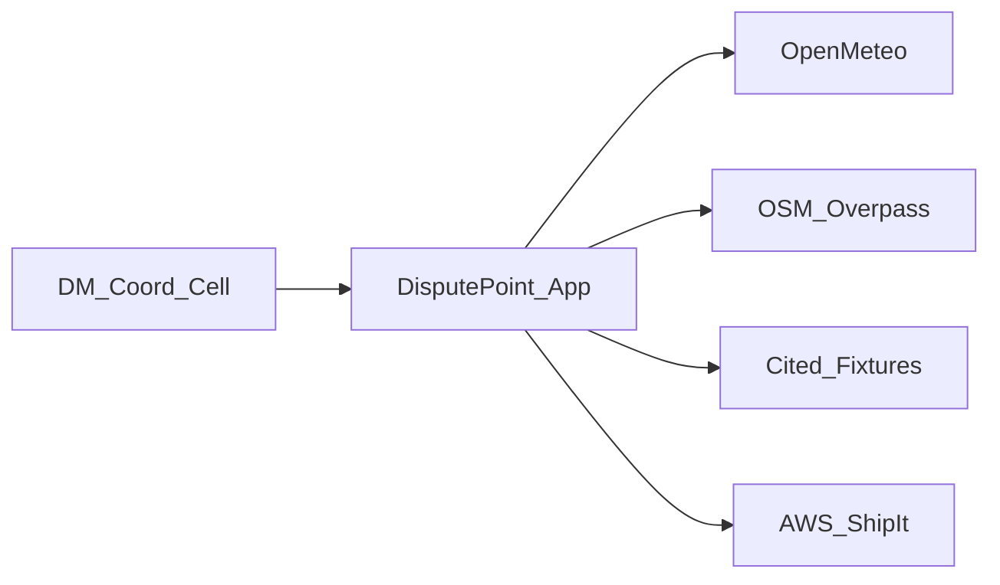
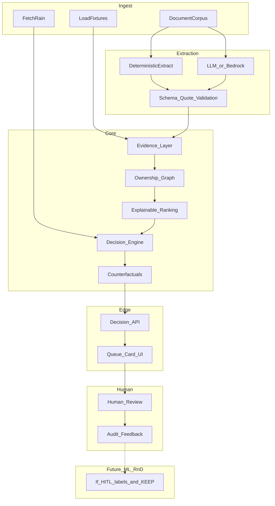
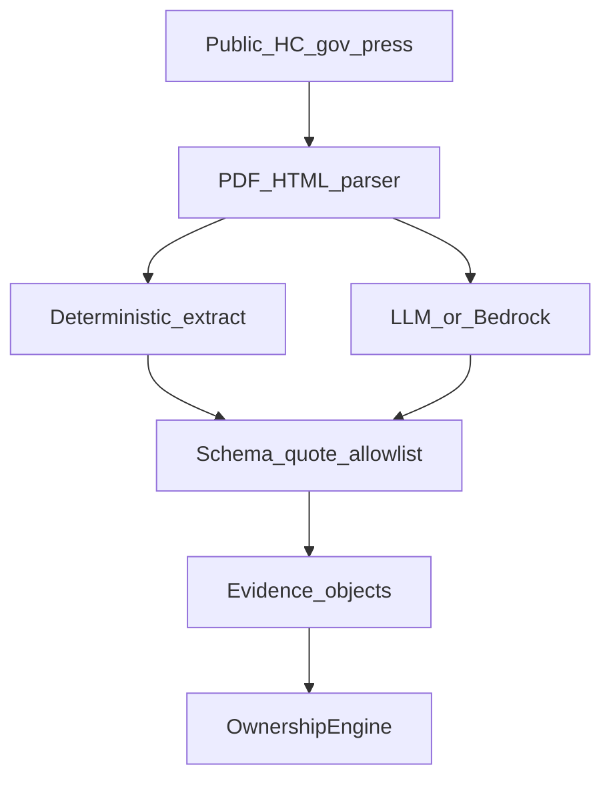

# High-Level Design — DisputePoint Response Intelligence

**Audience:** Someone who decides whether the shape is buildable before code.  
**Question:** What are the pieces, how do they connect, and why this shape?  
**Source of truth:** [PHASE6.md](PHASE6.md) Part III and §§15–16A. This file is an extract of the Phase 6 freeze. If this file and Phase 6 disagree, Phase 6 wins.  
**Claims:** Keep FACT / DERIVED / ASSUMPTION labels. Do not upgrade an assumption into a fact.  
**Not in this document:** Field regexes, the priority function, HTTP status codes, CSS hex values, React props. See [LLD.md](LLD.md) and [UX.md](UX.md).

**Reads with:** [PHASE6.md](PHASE6.md) · [PRD.md](PRD.md) · [LLD.md](LLD.md) · [UX.md](UX.md) · [research/aws-strategy-and-submission-notes.md](research/aws-strategy-and-submission-notes.md)

**Join key:** Module names. The PRD owns the FR id. This file names the module that carries that id. The LLD details the module.

---

## 1. Context



**Trust boundary**

- Fixtures and evidence are curated offline or LLM-validated.
- Rain is live with fallback.
- A human owns the final agency choice.
- Never claim CR or SCADA (Phase 6 §5 red).

---

## 2. Logical architecture



**MVP runtime (canonical):** Evidence → Ownership → Explainable Ranking → Decision → HITL.

ML is not a runtime component for the MVP (Phase 6 gate = no KEEP). Draw Future_ML as after labels only. Do not build ML abstractions now. Cognito and Location Service are out of the MVP.

---

## 3. Component catalog

| Component | Responsibility | In | Out | Fail soft | FR ids (primary) |
|-----------|----------------|----|-----|-----------|------------------|
| FixtureLoader | Load cited JSON | files | DisputePoint[] | Refuse invalid | FR-001, FR-019 |
| RainClient | Open-Meteo | lat/lon | RainObservation | Cache / slider | FR-006, FR-007, FR-022 |
| DocExtractor | Deterministic + optional Bedrock | docs | Evidence candidates | Manual fixtures | FR-025 |
| ProvenanceGuard | Enforce labels + license fields | objects | objects | Reject unmarked synth | FR-010, FR-019 |
| GeoService | Bbox + optional segment | points | GeoJSON | Point-only | FR-001, FR-014 |
| EvidenceStore | Index evidence | Evidence[] | by point | Empty → UNKNOWN | FR-002 |
| OwnershipEngine | Confidence / state / bands | evidence | agency or null | θ_assign | FR-003, FR-004, FR-011, FR-024 |
| PriorityEngine | Weighted P + counterfactuals | features | PriorityScore | Missing → 0 factor | FR-005, FR-013, FR-023 |
| HitlService | ACK / OVERRIDE / ESCALATE | human action | audit row | Reject bad transition | FR-012, FR-026 |
| DecisionAPI | HTTP | requests | JSON | 4xx / 5xx mapped | FR-008 path, NFR-001 |
| QueueUI | Ops shell | API | DOM | Mock mode | FR-008, FR-009, FR-020, FR-021 |
| DemoFallback | LIVE → CACHE → SLIDER | rain path | RainObservation | Banner | FR-007 |

Internal formulas live in [LLD.md](LLD.md). Screen states live in [UX.md](UX.md).

---

## 4. Rain re-rank flow

1. EventBridge, local cron, or UI slider produces a RainObservation.
2. PriorityEngine recomputes all points.
3. API returns the new order for the queue.
4. UI flashes changed ranks.

Ownership evidence does not refetch on rain. Evidence is static and curated. Only R and G may change on a rain event.

---

## 5. Deployment views

### Local-first (dev and demo reliability)

FastAPI + SQLite + filesystem fixtures + Vite UI (Phase 6 Part I §16).

### Ship It

S3 (static + fixtures) → CloudFront optional → API Gateway → Lambda → DynamoDB. EventBridge schedule. CloudWatch logs. SAM template. Cognito out.

**Status (2026-10-10):** Ship It **deployed** — live pins in [operations/AWS_OPERATOR.md](operations/AWS_OPERATOR.md) and [build/AWS_DEMO_BEAT.md](build/AWS_DEMO_BEAT.md). Phase 6 product locks unchanged; this is operator reality, not a Phase 6 reopen.

### Build It

SAM CLI / LocalStack once installed (Phase 6 Part I §2 — currently missing on the recon machine).

**Current defaults for open architecture questions**

| Question | Current default |
|----------|-----------------|
| θ_assign | 0.65 until §12B calibration |
| Bedrock extraction | Off unless §14A PASS |
| Ship It vs Build It | Prefer Ship It if Free Tier account works |

---

## 6. Security and tenancy

- Single-tenant demo. No multi-user auth in the MVP.
- Put secrets in env for any future IMD key.
- CORS: localhost plus the deployed origin.
- Public read API is OK for the hackathon. Document the risk.

---

## 7. Cross-cutting

| Concern | Approach |
|---------|----------|
| Logging | JSON lines with stage, request_id, point_id |
| Feature flag | `HIDE_SYNTHETIC=true` |
| Config | `THETA_ASSIGN=0.65`, weight JSON |
| Honesty | Global banner component |

Column shapes live in [LLD.md](LLD.md). Banner copy lives in [UX.md](UX.md).

---

## 8. Degradation map

| Failure | Behavior |
|---------|----------|
| Open-Meteo down | Slider + `Using scenario rain` |
| Evidence missing | UNKNOWN escalate; responsible_agency null |
| AWS down | Local URL for demo |
| Low confidence | responsible_agency null |
| ownership_state is CONFLICT | responsible_agency null always |

Same CONFLICT rule as [PRD.md](PRD.md) FR-004 / FR-011, [LLD.md](LLD.md) invariants, and [UX.md](UX.md) CONFLICT state.

---

## 9. Decision records

Status: Accepted. Source: Phase 6 freeze. See also [research/aws-strategy-and-submission-notes.md](research/aws-strategy-and-submission-notes.md).

### ADR-001 — No ML runtime in the MVP

- **Context:** Point set is about 15. Labels for supervised ranking are missing.
- **Decision:** Keep explainable weighted ranking. Do not run ML at demo time.
- **Rejected:** SageMaker, trained ranker on n≈15, predictive flood ML.

### ADR-002 — Ownership is a scored evidence graph

- **Context:** Agency assignment must be evidence-backed and reversible by a human.
- **Decision:** Score evidence types. Assign only if confidence ≥ θ (default 0.65). CONFLICT forces null agency. Optional LLM extraction cannot set agency by itself.
- **Rejected:** Cedar as ownership policy, LLM as silent owner, random agency pick.

### ADR-003 — SQLite local, DynamoDB when shipped

- **Context:** Need durable point state and HITL audit with Free Tier cost control.
- **Decision:** SQLite for local. DynamoDB for Ship It.
- **Rejected:** RDS, Aurora, OpenSearch, Neo4j.

### ADR-004 — FastAPI local, Lambda when shipped

- **Context:** Need a simple decision API and a clear AWS story.
- **Decision:** FastAPI functions locally. Package the same logic on Lambda behind API Gateway when shipped.
- **Rejected:** EKS, ECS, Fargate, Step Functions.

### ADR-005 — No Cognito

- **Context:** Single-tenant demo. A login wall slows the video.
- **Decision:** No Cognito in the MVP. Document open ACK risk.
- **Rejected:** Multi-user auth for the hackathon demo.

### ADR-006 — Queue and point card, not map-first

- **Context:** Prediction maps are saturated. Differentiation is ownership under rain.
- **Decision:** Home is the ranked queue plus point card. Amazon Location Service is **CUT**. **ADAPT:** optional MapLibre **secondary HUD** with discrete point markers (after human VERIFIED geocodes) and OSM/ODbL attribution — never primary nav; home must work with map closed (FR-020). Optional segment GeoJSON remains BUILD IF STABLE. In-screen Cmd+K and a judges eval link/drawer are allowed; they are **not** a multi-page SaaS shell.
- **Rejected:** Map-first hero, flood heatmap as home, Amazon Location Service as core UI, Cognito-heavy / Clerk admin chrome for MVP.

---

## 10. Cloud ↔ local substitute map

| Cloud | Local substitute | Product role |
|-------|------------------|--------------|
| S3 | `data/` filesystem | Fixtures, static UI, evidence cache |
| DynamoDB | SQLite | Points, status, HITL audit |
| Lambda | FastAPI / functions | Decision API + rain refresh |
| API Gateway | Local HTTP | HTTPS front door when shipped |
| EventBridge | asyncio / APScheduler | Scheduled rain poll |
| SNS | Log sink / UI toast | Optional top-priority alert |
| CloudWatch | stdout JSON logs | Observability |
| Bedrock | Recorded extraction fixtures | Optional Track 1 extract if §14A PASS |
| Cognito | — | Out of MVP |
| Location Service | — | Out of MVP (MapLibre secondary HUD ADAPT — ADR-006; not Amazon Location) |

---

## 11. Evidence and ownership pipeline



Rules:

- Demo seed evidence is manually curated and always available offline.
- LLM may propose Evidence. LLM may not set responsible_agency.
- Validation requires quote ⊆ source text, agency on allowlist, and schema pass.
- OwnershipEngine is deterministic over validated Evidence only.

---

## 12. HITL flow

```text
RECOMMENDATION → EVIDENCE ON CARD → HUMAN REVIEW
        ↓
   ACK | OVERRIDE | ESCALATE
        ↓
   AUDIT TRAIL → FEEDBACK ROW (no online learning in hackathon)
```

HitlService rejects illegal status transitions. DecisionAuditPanel is mandatory on the UI ([UX.md](UX.md)). Field list for OVERRIDE lives in [LLD.md](LLD.md).

---

## 13. AWS services — load-bearing roles

| Service | If removed, what breaks? | Keep? |
|---------|--------------------------|-------|
| EventBridge | No timed cloud rain ingest | YES |
| Lambda | No serverless decision API | YES |
| DynamoDB | No durable HITL trail in cloud | YES |
| S3 | No durable fixtures / static host | YES |
| API Gateway | No public HTTPS URL | YES |
| CloudWatch | Harder AWS proof in video | YES |
| SNS | UI toast still works | SHOULD if time |
| Bedrock | Manual fixtures still work | IF §14A green |
| Cognito | Not needed for single-tenant demo | CUT |
| Location Service | Queue-first product; map collision | CUT |

Judge line (**DERIVED**): EventBridge drives rain ingest, Lambda runs the decision engine, DynamoDB stores recommendations and overrides, S3 holds cited evidence, API Gateway serves the ops queue.

---

## 14. Observability stages

Structured JSON logs with `request_id`, `stage`, `point_id`, `model_version=weights_v1`, provenance flags, errors.

| stage | Meaning |
|-------|---------|
| ingest | Fixture or rain load |
| own | OwnershipEngine |
| rank | PriorityEngine |
| api | DecisionAPI request |
| hitl | ACK / OVERRIDE / ESCALATE |

CloudWatch when on AWS. Else stdout. Demo break → locate stage in under 30 seconds (Phase 6 §26).

---

## 15. NFR → architecture mapping

| NFR | Architecture response |
|-----|----------------------|
| NFR-001 / NFR-002 | Pure-function rank over ~15 points; no remote fan-out on GET /points |
| NFR-003 | Fixtures + SQLite + offline shell; rain slider fallback |
| NFR-004 | Secrets only in env / SSM; never commit `.env` |
| NFR-005 | Tiny fixtures; EventBridge poll ≥5–15 min; no per-keystroke Bedrock |
| NFR-006 | JSON logs with request_id |
| NFR-007 / NFR-008 | Queue-first UI per [UX.md](UX.md) |
| NFR-009 | Lockfiles + `make install|test|run` |
| NFR-010 | ProvenanceGuard + LICENSE_AUDIT |

---

## 16. Trust and threat notes (MVP)

| Risk | Mitigation |
|------|------------|
| Invented coordinates | FixtureLoader + GeoService bbox reject |
| LLM hallucinated quote | quote⊆source validation; fail closed |
| Silent agency under CONFLICT | OwnershipEngine invariant + UI |
| Open public ACK | Document hackathon risk; single-tenant |
| AWS outage during demo | Local URL + slider path |

---

## 17. Scale envelope (hackathon)

- About 12–15 DisputePoints in the demo corpus.
- Rank recompute under 50 ms for 15 points (NFR-002).
- No citywide hydraulic model.
- No horizontal service mesh.
