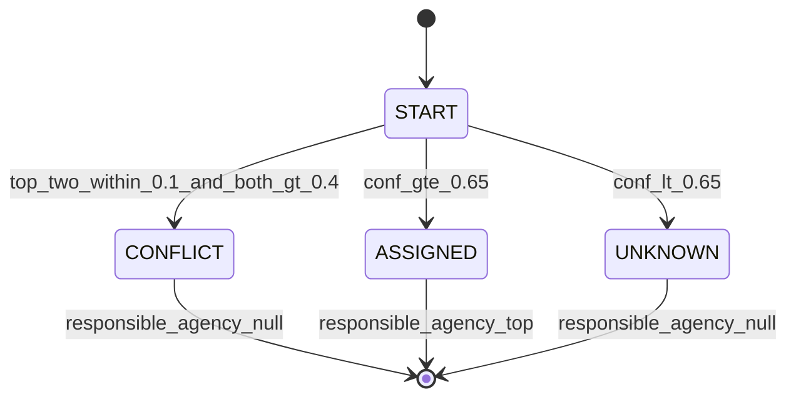
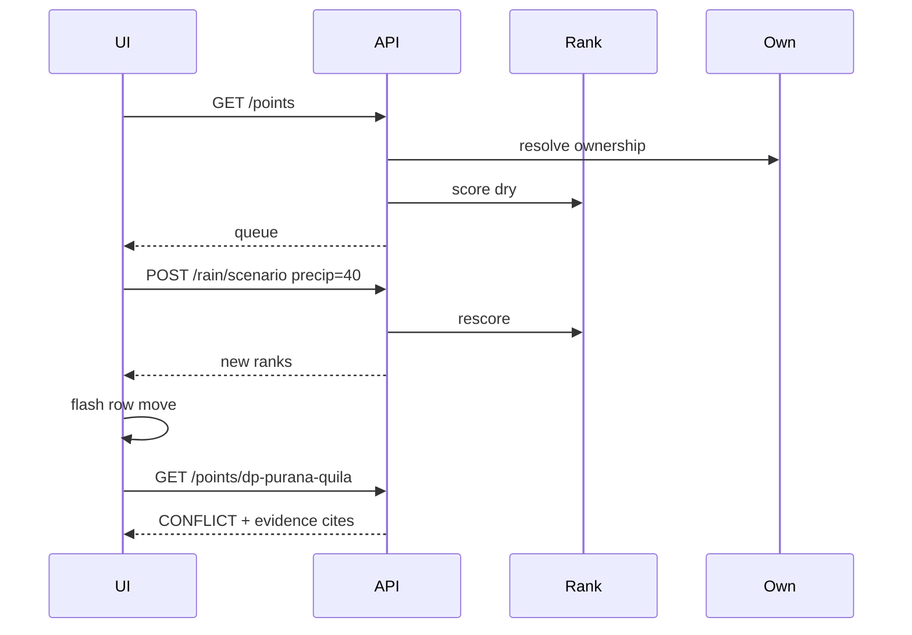

# Low-Level Design — DisputePoint Response Intelligence

**Audience:** The person or agent who writes Phase 7 code.  
**Question:** How does each module behave, exactly?  
**Source of truth:** [PHASE6.md](PHASE6.md) Part IV and [schemas/](schemas/). This file is an extract of the Phase 6 freeze. If this file and Phase 6 disagree, Phase 6 wins. If this file and a JSON schema disagree, the JSON schema wins, then Phase 6.  
**Claims:** Keep FACT / DERIVED / ASSUMPTION labels. Do not upgrade an assumption into a fact.  
**Not in this document:** Why the product exists, prize strategy, banned fonts. See [PRD.md](PRD.md) and [UX.md](UX.md).

**Reads with:** [PHASE6.md](PHASE6.md) · [PRD.md](PRD.md) · [HLD.md](HLD.md) · [UX.md](UX.md) · [schemas/](schemas/)

**Join key:** Module names from [HLD.md](HLD.md), FR ids from [PRD.md](PRD.md), screen regions named in [UX.md](UX.md).

---

## 1. Ownership states



## 2. Golden Purana Quila sequence



---

## 3. Repo layout (Phase 7 create)

```text
/Users/vaibhavsingh/disputepoint/
  data/fixtures/points.json
  data/fixtures/evidence.json
  data/fixtures/readiness.json
  docs/schemas/
  docs/phases/PHASE5.md docs/PHASE6.md
  docs/PRD.md docs/HLD.md docs/LLD.md docs/UX.md
  backend/
    app/main.py
    app/models/
    app/services/ownership.py
    app/services/priority.py
    app/services/rain.py
    app/db/
  frontend/
    src/App.tsx
    src/styles/tokens.css
    src/components/QueueTable.tsx
    src/components/PointCard.tsx
    src/components/EvidenceList.tsx
    src/components/RainControl.tsx
    src/components/AdvisoryBanner.tsx
    src/components/MapHUD.tsx
    src/components/CommandPalette.tsx
    src/components/EvalDrawer.tsx
  infra/template.yaml
  tests/
  scripts/
```

`MapHUD.tsx` — BUILD IF STABLE secondary HUD ([UX.md](UX.md), [build/DEMO_WOW.md](build/DEMO_WOW.md)); collapse when lat/lon null.  
`CommandPalette.tsx` — `cmdk` same-screen point jump.  
`EvalDrawer.tsx` — optional; footer EvalLink alone is enough until GAP-EVAL-01/02 filled.

---

## 4. Schema field dictionary (DisputePoint)

Authoritative JSON schemas:

- [schemas/DisputePoint.schema.json](schemas/DisputePoint.schema.json)
- [schemas/Evidence.schema.json](schemas/Evidence.schema.json)
- [schemas/RainObservation.schema.json](schemas/RainObservation.schema.json)
- [schemas/PriorityScore.schema.json](schemas/PriorityScore.schema.json)

| Field | Type | Req | Validation | Provenance |
|-------|------|-----|------------|------------|
| id | string | Y | `^dp-[a-z0-9-]+$` | curated |
| name | string | Y | min 1 | cite |
| lat, lon | number | Y | Delhi bbox 28.4–28.9 / 76.8–77.5 | derived geocode |
| agencies_claimed | enum[] | Y | allowlist | evidence |
| evidence_ids | string[] | Y | min 1 | — |
| ownership_confidence | 0..1 | Y | — | computed |
| ownership_state | enum | Y | ASSIGNED \| CONFLICT \| UNKNOWN | computed |
| responsible_agency | string \| null | Y | null if under θ or CONFLICT | computed |
| severity, recurrence | number / string | Y / S | — | historical / proxy |
| readiness | object | S | is_synthetic required | fixture |
| priority_score / rank | number / int | Y | — | computed |
| recommended_action | string | Y | template | derived |
| status | enum | Y | OPEN \| ACKED \| RESOLVED | runtime |
| provenance | object | Y | is_synthetic, is_derived | always |

Evidence, Rain, and PriorityScore fields: see the JSON Schema files.

---

## 5. OwnershipEngine state machine

```text
START
  → collect Evidence for point
  → score agencies by type weights: COURT=1.0, GOV=0.85, QUOTE=0.7, PRESS=0.55, HEURISTIC=0.35
  → conf = min(1, sum(weights_for_top_agency)/W_NORM)  # W_NORM = 2.0
  → if top two within 0.1 and both >0.4 → CONFLICT (responsible=null ALWAYS)
  → else if conf >= 0.65 → ASSIGNED (responsible=top)
  → else → UNKNOWN (responsible=null)
```

**Invariants (tests lock)**

1. If `ownership_state == CONFLICT`, then `responsible_agency is None`. Absolute. CONFLICT overrides ASSIGNED even if top ≥ θ. Test `T-OWN-CF-NULL`.
2. If `responsible_agency is not None`, then `ownership_state == ASSIGNED` and conf ≥ θ.
3. If `ownership_state == UNKNOWN`, then `responsible_agency is None`.

θ_assign frozen at **0.65** until fixture gold exists (§12B may recalibrate later; do not soft-change in code without an amendment).

---

## 6. PriorityEngine function

```python
WEIGHTS = dict(R=0.25, S=0.25, C=0.15, Q=0.15, U=0.15, G=0.05)
THETA = 0.65
# U = coordination_uncertainty (response bottleneck), NOT physical flood severity

def priority(point, rain, hide_synthetic=False):
    R = normalize_rain(rain.precip_mm)          # 0..1 physical urgency from rain
    S = point.severity
    C = 1.0 if point.is_arterial or point.is_underpass else 0.4
    Q = recurrence_to_unit(point.recurrence_class)
    U = 1.0 - point.ownership_confidence        # coordination_uncertainty
    if point.ownership_state == "CONFLICT":
        U = max(U, 0.8)                         # conflict = coordination bottleneck
    G = readiness_gap(point.readiness)
    if hide_synthetic and point.readiness and point.readiness.is_synthetic:
        G = 0.0
    comps = dict(R=R, S=S, C=C, Q=Q, U=U, G=G)
    score = sum(WEIGHTS[k]*comps[k] for k in WEIGHTS)
    explain = [f"{k}={comps[k]:.2f}×{WEIGHTS[k]}" for k in WEIGHTS]
    return score, comps, explain
```

U is coordination uncertainty. Do not call U flood severity.

---

## 7. DecisionAPI routes

| Method | Path | Response | Errors |
|--------|------|----------|--------|
| GET | `/health` | `{ok:true, rain_mode:live\|cache\|slider}` | — |
| GET | `/points` | `{items: DisputePointPublic[]}` sorted by priority_rank | 500 |
| GET | `/points/{id}` | card payload + evidence[] + priority components | 404 |
| POST | `/rain/refresh` | RainObservation | 503 → use cache |
| POST | `/rain/scenario` | `{precip_mm}` body → RainObservation is_synthetic=true | 400 |
| POST | `/points/{id}/ack` | Incident | 404 / 409 |
| POST | `/points/{id}/override` | body: agency, reason, reviewer → audit | 400 / 404 |
| POST | `/points/{id}/escalate` | body: reason, reviewer → audit | 404 |
| GET | `/meta/honesty` | policy strings + theta + weights + U semantics | — |

Nine routes. Do not add extras without a Phase 6 amendment.

**Example `GET /points/{id}` fragment**

```json
{
  "id": "dp-purana-quila",
  "ownership_state": "CONFLICT",
  "responsible_agency": null,
  "ownership_confidence": 0.58,
  "priority_score": 0.77,
  "advisory": true,
  "evidence": [{"type": "COURT_ORDER", "quote": "Jurisdiction PWD", "url": "https://www.livelaw.in/..."}],
  "readiness": {"state": "UNKNOWN", "is_synthetic": false}
}
```

---

## 8. Frontend module tree

This is the only place component file names appear. Screen regions without file names live in [UX.md](UX.md).

```text
App
├── AdvisoryBanner (global)
├── TopBar (title, RainControl, HideSyntheticToggle)
├── CommandPalette (⌘K → selectedPointId; optional focus rain / audit)
├── SplitPane
│   ├── QueueColumn
│   │     ├── QueueTable (props: items[], selectedId, onSelect)
│   │     │     rows: RankIndex, Name, StateChip, AgencyCell, MonoScore
│   │     └── MapHUD (BUILD IF STABLE; props: points, selectedId, onSelect)
│   │           collapsed/empty when no VERIFIED lat/lon
│   └── PointCard (props: point, evidence[], audit?)
│         ├── StateChip / AgencyBlock
│         ├── PriorityExplain (component bars + counterfactual chips)
│         ├── EvidenceList (dl/dt/dd)
│         ├── ReadinessBlock (SYNTHETIC badge)
│         ├── ActionBlock
│         │     ├── ACK
│         │     ├── OVERRIDE (agency selector, reason, confirm)
│         │     └── ESCALATE (reason)
│         ├── DecisionAuditPanel
│         │     SYSTEM RECOMMENDED | agency + confidence
│         │     HUMAN DECISION | agency | REASON | TIME
│         └── ProvenanceFooter
└── EvalLink / EvalDrawer (judges; footer; mirrors tests/eval — no new API)
```

HITL UI is mandatory. OVERRIDE and ESCALATE must not be backend-only (FR-012).

`tokens.css` holds variables from [UX.md](UX.md). Load IBM Plex Sans and Mono once.

QueueTable: prefer headless TanStack Table for row model/selection; styles from [design/DESIGN_SYSTEM.md](design/DESIGN_SYSTEM.md). Do not import shadcn dashboard starters or Next.js admin templates.

MapHUD: `react-map-gl/maplibre` secondary only — never map-first home (FR-020). No new OpenAPI routes for map, palette, or eval UI.

---

## 9. Persistence

### SQLite (local)

| Table | Keys | Columns |
|-------|------|---------|
| points | id PK | json blob + priority_score + status |
| evidence | id PK | point_id FK, json |
| rain_cache | id=1 | precip_mm, retrieved_at, mode |
| audit | id AI | point_id, action, ts |

### DynamoDB (AWS)

| PK | SK | Entity |
|----|----|--------|
| `POINT#id` | `META` | point |
| `POINT#id` | `EV#eid` | evidence |
| `POINT#id` | `AUDIT#ts` | ack |
| `CONFIG` | `RAIN` | cache |

---

## 10. FR → test matrix

### Mapped in Phase 6 Part IV.9

| FR | Test ID | Type |
|----|---------|------|
| FR-001 | T-DATA-01 | unit |
| FR-004 | T-OWN-θ | unit |
| FR-005 | T-RANK-01 | unit |
| FR-006 / FR-007 | T-RAIN-01 | integration |
| FR-008 / FR-009 | T-UI-01 | e2e |
| FR-010 | T-UI-SYN | e2e |
| FR-011 | T-OWN-CF-NULL | unit + e2e |
| FR-012 | T-HITL-UI | e2e |
| FR-017 | T-GOLD-PQ | e2e |
| FR-019 | T-PROV-01 | contract |
| FR-027 | T-KPI-TRIAGE | demo timing |
| NFR-008 | T-VIS-AUDIT | checklist |

### Unmapped in Phase 6 Part IV.9

Acceptance remains the FR or NFR text in [PRD.md](PRD.md). No extra test id was assigned in Phase 6. Do not invent test ids.

- FR-002, FR-003
- FR-013, FR-014, FR-015, FR-016, FR-018
- FR-020, FR-021, FR-022, FR-023, FR-024, FR-025, FR-026
- NFR-001, NFR-002, NFR-003, NFR-004, NFR-005, NFR-006, NFR-007, NFR-009, NFR-010

---

## 11. Error codes

| Code | Meaning | Client |
|------|---------|--------|
| DP-400-SCHEMA | Fixture / API validation | Fix payload |
| DP-404-POINT | Unknown id | Toast |
| DP-503-RAIN | Upstream rain fail | Auto slider suggest |
| DP-409-ACK | Bad status transition | Refresh |
| DP-422-THETA | Attempt assign below θ | Impossible via API |

---

## 12. Seed fixture list

Cite. Do not invent. Each row needs a `source_url` from Phase 4 Gate A.

Fixture validation uses [DisputePointSeed.schema.json](schemas/DisputePointSeed.schema.json); runtime API responses use [DisputePoint.schema.json](schemas/DisputePoint.schema.json).

**Authoritative recipes:** [build/DATA_PLAYBOOK.md](build/DATA_PLAYBOOK.md) (Gate A rows 1–14). Must include the priority demo spine listed there (`dp-purana-quila`, `dp-minto-bridge`, `dp-barapullah`, …). Prefer all 14 when extracts are ready.

Do not add point names beyond the playbook without a Phase 6 amendment. DM-71 bulk is a mandate cite, not a point.

---

## 13. Evidence schema dictionary

Authoritative file: [schemas/Evidence.schema.json](schemas/Evidence.schema.json).

| Field | Type | Req | Validation |
|-------|------|-----|------------|
| id | string | Y | non-empty |
| type | enum | Y | COURT_ORDER \| GOV_ORDER \| AGENCY_QUOTE \| PRESS_REPORT \| SPATIAL_HEURISTIC |
| url | string | Y | source URL |
| quote | string | Y | minLength 10; must ⊆ source after validation |
| agency | string \| null | Y | allowlist or null |
| location_span | string \| null | N | — |
| source_date | string \| null | N | — |
| retrieved_at | date-time | Y | — |
| weight | number | Y | 0..1 (type default: COURT 1.0, GOV 0.85, QUOTE 0.7, PRESS 0.55, HEURISTIC 0.35) |
| needs_review | boolean | N | default false; true until validation for LLM extracts |
| is_synthetic | boolean | Y | — |

---

## 14. RainObservation schema dictionary

Authoritative file: [schemas/RainObservation.schema.json](schemas/RainObservation.schema.json).

| Field | Type | Req | Validation |
|-------|------|-----|------------|
| lat, lon | number | Y | Delhi-relevant coords for the poll |
| window_hours | number | Y | aggregation window |
| precip_mm | number | Y | ≥ 0 |
| source | enum | Y | open-meteo \| imd \| fixture \| scenario_slider |
| retrieved_at | date-time | Y | — |
| is_synthetic | boolean | Y | true for scenario_slider and many fixtures |

---

## 15. PriorityScore schema dictionary

Authoritative file: [schemas/PriorityScore.schema.json](schemas/PriorityScore.schema.json).

| Field | Type | Req |
|-------|------|-----|
| point_id | string | Y |
| score | number | Y |
| components.R/S/C/Q/U/G | number | Y |
| weights | object | N |
| explanation | string[] | N |
| computed_at | date-time | Y |

Card payload SHOULD also include `counterfactuals: [{factor, score_before, score_after, delta}]` (Phase 6 §12A).

---

## 16. Uncertainty bands

| Band | ownership_confidence | UI |
|------|----------------------|-----|
| HIGH | 0.85–1.00 | ASSIGNED (advisory) |
| MEDIUM | 0.65–0.85 | ASSIGNED with caution chip |
| UNCERTAIN | &lt; 0.65 | responsible_agency=null; escalate |

UNCERTAIN is a successful honest output. It is not an error (FR-024).

---

## 17. Worked example — ownership CONFLICT

Illustrative numbers for tests. Do not invent new source quotes; swap in Phase 4 cites at fixture time.

Given evidence weights for two agencies on `dp-purana-quila`:

- PWD: COURT 1.0 + PRESS 0.55 → raw 1.55
- NDMC: GOV 0.85 + QUOTE 0.7 → raw 1.55

Normalize with **W_NORM = 2.0** so conf values sit in 0..1:

- PWD conf = min(1, 1.55/2.0) = 0.775
- NDMC conf = min(1, 1.55/2.0) = 0.775

Top two within 0.1 and both &gt; 0.4 → **CONFLICT**.

Result:

```json
{
  "ownership_state": "CONFLICT",
  "ownership_confidence": 0.775,
  "responsible_agency": null
}
```

Even if one agency later scores 0.70, CONFLICT still forces null until human adjudication. Test `T-OWN-CF-NULL`.

---

## 18. Worked example — priority with rain

Assume components before rain: R=0.2, S=0.8, C=1.0, Q=0.7, U=0.8 (CONFLICT floor), G=0.0.

```text
P = 0.25*0.2 + 0.25*0.8 + 0.15*1.0 + 0.15*0.7 + 0.15*0.8 + 0.05*0.0
  = 0.05 + 0.20 + 0.15 + 0.105 + 0.12 + 0
  = 0.625
```

After scenario rain R → 0.9:

```text
P = 0.25*0.9 + 0.25*0.8 + 0.15*1.0 + 0.15*0.7 + 0.15*0.8 + 0
  = 0.225 + 0.20 + 0.15 + 0.105 + 0.12
  = 0.800
```

Δ from R alone ≈ +0.175. Counterfactual chip: Why now? Rain increased triage urgency.

U stays coordination uncertainty. Do not label the U contribution as “more flood risk.”

---

## 19. Counterfactual computation

For each top-ranked demo point, perturb one factor at a time. Store Δpriority.

| Perturbation | Expected direction |
|--------------|-------------------|
| Zero R | Priority drops |
| Resolve U (lower coordination uncertainty) | Priority drops |
| Zero Q | Priority drops |
| Zero G | Priority drops |

UI copy MUST (Phase 6 §12A):

- **Why now?** Rain and/or coordination uncertainty increased triage urgency by +X% (not “more flood risk” from U alone).
- **Why this location?** Chronic flooding + unresolved agency responsibility (coordination bottleneck).
- **Why this agency?** N supporting evidence, M conflicting; advisory only. CONFLICT → no auto-agency.

---

## 20. HITL transitions and audit fields

| Action | From status | To status | Required body | Gate |
|--------|-------------|-----------|---------------|------|
| ACK | OPEN | ACKED | reviewer | Only if `ownership_state == ASSIGNED` |
| OVERRIDE | OPEN | ACKED | agency, reason, reviewer | Allowed for ASSIGNED / CONFLICT / UNKNOWN |
| ESCALATE | OPEN | OPEN or escalated flag | reason, reviewer | Allowed for all states |

MVP locks: **no ACK** on CONFLICT or UNKNOWN. **OVERRIDE only from OPEN** (not from ACKED). **RESOLVED** deferred — do not implement RESOLVED transitions in MVP.

**Required on OVERRIDE** (Phase 6 §15A):

| Field | Required |
|-------|----------|
| recommended_agency | Y |
| human_selected_agency | Y |
| override_reason | Y |
| reviewer | Y |
| timestamp | Y |
| previous_recommendation snapshot | Y |
| final_decision | Y |
| action_taken / eventual_outcome | SHOULD |

Write a feedback dataset row. Do not train online in the hackathon (FR-026).

Illegal transition → `DP-409-ACK`.

---

## 21. API request and response bodies

### POST `/rain/scenario`

Request:

```json
{ "precip_mm": 40 }
```

Response: RainObservation with `source: "scenario_slider"`, `is_synthetic: true`.

### POST `/points/{id}/override`

Request:

```json
{
  "agency": "PWD",
  "reason": "HC section cites PWD for this span",
  "reviewer": "demo-officer"
}
```

Response: audit object including recommended vs human agency.

### GET `/meta/honesty`

Response includes policy strings, `THETA_ASSIGN`, weight map, and U semantics text: coordination uncertainty, not physical severity.

### GET `/points/{id}` extras

Beyond DisputePointPublic: `evidence[]`, `components`, `explanation[]`, `counterfactuals[]`, `advisory: true`, optional `audit`.

---

## 22. Baseline tournament (eval)

Mandatory methods (Phase 6 §12). ML row only if KEEP (MVP: skip).

| Method | Role |
|--------|------|
| Random | Control |
| Severity-only | Heuristic |
| Rain-only | Heuristic |
| Static hotspot priority | Heuristic |
| Recurrence-only | Heuristic |
| Nearest-agency heuristic | Weak ownership |
| Weighted P (ours) | Target |
| ML model | Only if KEEP — out of MVP |

Metrics: top-k agreement, Spearman/Kendall vs fixture gold triage order, ownership accuracy, evidence coverage, false assignment rate, uncertainty calibration. Report path: `tests/eval/baseline_tournament.md` (Phase 7).

**UI (optional judges aid):** footer link and/or `EvalDrawer` may mirror this report. Markdown remains FR-015 MUST. Do not invent metric values for the UI; link-out is enough while GAP-EVAL-01/02 are open ([build/DEMO_WOW.md](build/DEMO_WOW.md) J2).

---

## 23. Agency allowlist

From DisputePoint schema enum:

`PWD`, `MCD`, `NDMC`, `IFC`, `DDA`, `DJB`, `RAILWAYS`, `CPWD`, `OTHER`, `UNKNOWN`

Reject Evidence.agency outside this set during validation.

---

## 24. Implementation locks

Constants agents must not soft-change without a Phase 6 amendment. Inventory: [build/GAPS.md](build/GAPS.md). Fixtures: [build/DATA_PLAYBOOK.md](build/DATA_PLAYBOOK.md).

| Lock | Value |
|------|-------|
| `W_NORM` | `2.0` |
| `θ_assign` / `THETA` | `0.65` until fixture gold |
| `window_hours` | `6` |
| Poll interval | `15` minutes |
| Wet demo `precip_mm` | `40` |
| Dry demo `precip_mm` | `0` |
| UI kit | CSS variables + React (no `@carbon/react` unless later ADR) |
| Bedrock | Off — fixtures-only evidence |
| SNS / CloudFront | Out of MVP |
| Deploy preference | Prefer Ship It; day-1 recon may choose Build It if account/SAM blocked |

### Helper functions (locked)

```python
W_NORM = 2.0
THETA = 0.65

def normalize_rain(precip_mm: float) -> float:
    # ASSUMPTION: 50 mm in window ≈ full rain urgency
    return min(1.0, max(0.0, precip_mm / 50.0))

def recurrence_to_unit(recurrence_class: str) -> float:
    return {
        "chronic": 1.0,
        "recurring": 0.7,
        "occasional": 0.4,
        "unknown": 0.2,
    }[recurrence_class]

def readiness_gap(readiness, hide_synthetic: bool = False) -> float:
    if hide_synthetic and readiness.get("is_synthetic"):
        return 0.0
    state = readiness.get("state")
    return {"OK": 0.0, "GAP": 1.0, "UNKNOWN": 0.5}[state]
```

### Open-Meteo HTTP

```text
GET https://api.open-meteo.com/v1/forecast
  ?latitude=28.6139
  &longitude=77.2090
  &hourly=precipitation
  &past_hours=6
  &forecast_hours=0
  &timezone=Asia%2FKolkata
```

Map: sum `hourly.precipitation` → `precip_mm`; `source=open-meteo`; `is_synthetic=false` on 200. Non-200 → cache then scenario slider (`Using scenario rain`). IMD only if `IMD_API_KEY` present; never block demo.

### Counterfactual %

`round(100 * delta / max(score_before, 1e-6))` with sign. UI copy stems stay in [UX.md](UX.md) §18.

### RainΔ (API/UI)

`previous_priority_rank - current_priority_rank` (signed integer). Positive means the point **rose** in the queue (rank number decreased).
