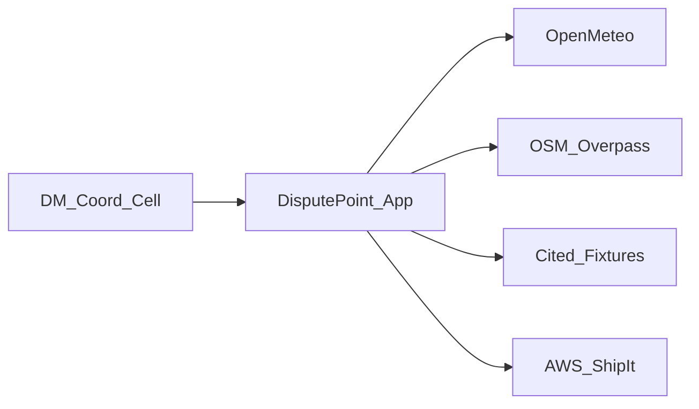
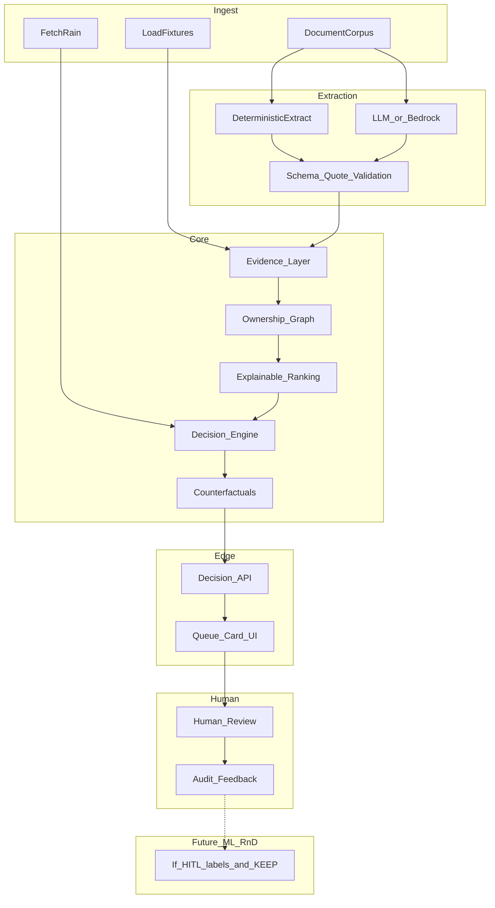
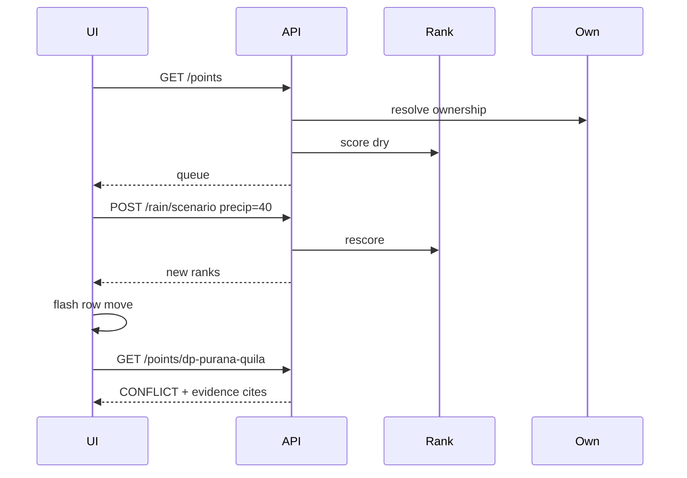

# Phase 6 — Agent Implementation Planning & Execution Design

**Hackathon:** [WeMakeDevs × AWS Environmental Hacks](https://www.wemakedevs.org/aws/env) — Bharat Builds Tour  
**Rules:** [https://www.wemakedevs.org/aws/rules](https://www.wemakedevs.org/aws/rules)  
**Project:** DisputePoint Response Intelligence  
**Mode:** IMPLEMENTATION PLANNING + ENVIRONMENT DISCOVERY — **not** unrestricted coding  
**Product SoT:** [`phase5-build-strategy.md`](./phase5-build-strategy.md)  
**Inputs:** Phases 1–5; probe log [`../05-research-artifacts/phase6/probes/probe-log.md`](../05-research-artifacts/phase6/probes/probe-log.md); schemas [`../05-research-artifacts/phase6/schemas/`](../05-research-artifacts/phase6/schemas/)  
**Constraint:** validated execution capacity, not lines of code / not human typing speed.

### Path redirects (GAP-DRIFT-01)

Legacy research-layout links in this file may 404 in the product repo. Prefer the paths below; do not treat this table as a product reopen.

| Legacy path | Product-repo path |
|-------------|-------------------|
| `phase5-build-strategy.md` | [`phases/PHASE5.md`](phases/PHASE5.md) |
| `05-research-artifacts/phase6/schemas/` | [`schemas/`](schemas/) |
| `05-research-artifacts/phase6/probes/probe-log.md` | [`research/probe-log.md`](research/probe-log.md) |
| `05-research-artifacts/phase6/ux-anti-slop-research.md` | [`research/ux-anti-slop-research.md`](research/ux-anti-slop-research.md) |
| `05-research-artifacts/phase6/ml-llm-opportunity-gate.md` | [`research/ml-llm-opportunity-gate.md`](research/ml-llm-opportunity-gate.md) |
| `05-research-artifacts/phase6/aws-strategy-and-submission-notes.md` | [`research/aws-strategy-and-submission-notes.md`](research/aws-strategy-and-submission-notes.md) |

### Document map

| Part | Contents | Audience |
|------|----------|----------|
| **Part I** | §§0–42 Agent planning, validation loops, submission/judge gates, master prompt | Orchestrator agents |
| **Part II** | PRD — functional/non-functional requirements, stories, trust | Product + implementers |
| **Part II-B** | Visual Design & Anti-Slop Spec | Frontend agents |
| **Part III** | HLD — architecture, deploy, data flows | Backend/AWS agents |
| **Part IV** | LLD — schemas, algorithms, API, UI tree, persistence, tests | Coding agents |
| UX research | [`../05-research-artifacts/phase6/ux-anti-slop-research.md`](../05-research-artifacts/phase6/ux-anti-slop-research.md) | Design grounding |
| ML/LLM gate | [`../05-research-artifacts/phase6/ml-llm-opportunity-gate.md`](../05-research-artifacts/phase6/ml-llm-opportunity-gate.md) | AI discovery verdicts |
| AWS/submission | [`../05-research-artifacts/phase6/aws-strategy-and-submission-notes.md`](../05-research-artifacts/phase6/aws-strategy-and-submission-notes.md) | Why-AWS + package |

**Core judge question:** Why should I believe this recommendation, and why is it better than a simple rule / map / dashboard?

### A–T theme map (overlay on §§)

| Letter | Theme | Section(s) |
|--------|-------|------------|
| A | Product implementation contract | §§0–4, Part II |
| B | Data + provenance + license gate | §§5–8, §37, Part IV |
| C | ML opportunity discovery | §13, §13A + ML gate artifact |
| D | LLM / Bedrock opportunity + eval | §11, §14, §14A + ML gate artifact |
| E | Decision + uncertainty + counterfactuals | §12, §12A, §12B |
| F | HITL + feedback | §15A |
| G | Baseline tournament | §12 |
| H | Technical architecture | §§7–10, Part III |
| I | AWS strategy (why AWS) | §15, §16A |
| J | UX + a11y | Part II-B, NFRs |
| K–L | Agents + recovery | §§17–20, §40 |
| M | Testing + adversarial | §§22–24, §38 |
| N | Reproducibility + disaster | §§30, §41 |
| O | License/compliance audit | §37 + AWS notes |
| P | Demo architecture (video-first) | §39 |
| Q | Judge-blind evaluation | §38 |
| R | Submission engineering | §37 |
| S | Final pre-clock gate | §42 |
| T | Master coding-agent prompt | §36 |

Phase 5 remains product SoT for *what*; Parts II–IV + Part I are SoT for *requirements / design / how to build*. After §§12A–16A and §§37–42 land, **Phase 6 is frozen** for Phase 7 (no further idea expansion).

---

# PART I — Agent Implementation Planning (§§0–42)

# §0 Mission

Convert Phase 5 into a plan that coding agents can execute in Phase 7 without inventing the product, hallucinating data, or colliding on interfaces.

**Do not** reopen opportunity discovery. Flag Phase 5 contradictions with smallest correction only (none blocking found; notes in §32).

---

# §1 First Principle — Genuinely Working Chain

```text
REAL / VERIFIED INPUT (fixtures + Open-Meteo + evidence quotes)
        ↓
DATA PROCESSING (validate / normalize / provenance)
        ↓
EVIDENCE / GEO MODEL (point±segment + evidence graph)
        ↓
DECISION ENGINE (ownership θ_assign + weighted priority)
        ↓
ACTIONABLE OUTPUT (agency|UNCERTAIN + action + explain)
        ↓
USER INTERACTION (queue + point-card + ACK)
        ↓
MEASURABLE RESULT (golden e2e + baselines + labeled synthetic)
```

| Link | Acceptance test |
|------|-----------------|
| Input | Fixture schema validates; Open-Meteo probe or fixture rain loads |
| Processing | Every field has provenance; reject invent coords |
| Evidence/Geo | ≥1 evidence per point; Delhi bbox lat/lon |
| Decision | `responsible_agency is None` if confidence < 0.65; rank explainable |
| Output | API returns output contract fields |
| UI | Queue shows who/why in <10s; SYNTHETIC badge if used |
| Result | Golden Purana Quila scenario green; tests pass |

UI render alone ≠ done.

---

# §2 Phase 5 Corrections (smallest)

| Item | Note |
|------|------|
| SAM / LocalStack | Phase 5 assumed Build It path — **CLIs missing on machine**; Phase 7 must `brew install` / pip install before AWS work |
| IMD primary | Phase 5 listed IMD secondary — probe = **401 without key**; keep Open-Meteo primary (**confirmed**) |
| AWS identity | STS not verified in recon — Free Tier login is Phase 7 gate before Ship It |
| No product contradiction on decision object / θ_assign / queue UX | — |

---

# §3 Environment Reconnaissance

| Item | Observed |
|------|----------|
| OS | macOS 26.3 Darwin 25.3.0 |
| Arch | arm64 Apple M1 (Metal GPU 7 cores) |
| Disk | ~228 Gi volume; ~11 Gi free on root (monitor — may need cleanup) |
| Python | 3.12.1 |
| Node | v22.17.0 / npm 10.9.2 |
| Package managers | uv, pip; poetry not found |
| Docker | 28.5.1 |
| Git | 2.39.5 |
| AWS CLI | 2.28.16 |
| SAM | **missing** |
| LocalStack | **missing** |
| Browser automation | Cursor browser tools available in agent sessions |
| Coding agents | Cursor agents / Task tools available |

---

# §4 Repository Safety

| Item | Value |
|------|-------|
| Research repo path | `/Users/vaibhavsingh/market-research` |
| Branch | `feat/research-os` → `origin/feat/research-os` |
| Working tree | **DIRTY** (research_os WIP + untracked tests/scripts) |
| Remote | `https://github.com/vaibhav11123/market-research.git` |
| Existing DisputePoint code | **None** |

### Safe strategy (locked)

1. **Preserve** all dirty `feat/research-os` work — do not commit product into it; do not reset.  
2. **Product root:** new git repository at **`/Users/vaibhavsingh/disputepoint`** (sibling of `market-research`).  
3. Phase 7: `mkdir` + `git init` + `main` branch + remote when ready.  
4. Research phases remain in `market-research/runs/environmental-hacks-deep-2026/`.  
5. Copy Phase 5/6 + schemas into `disputepoint/docs/` at scaffold time (read-only reference).  
6. Never overwrite unrelated research_os files.

---

# §5 Data Access Reality Check

| Dataset | Exists? | Accessible? | Downloadable? | Usable format? | Geo OK? | Fresh? | License | Hackathon? | Key? | Returns need? | Class | Fallback |
|---------|---------|-------------|---------------|----------------|---------|--------|---------|------------|------|---------------|-------|----------|
| Open-Meteo precip | Y | Y | API | JSON | Delhi | Live | Free | Y | N | Y | 🟢 | Scenario slider + cache |
| IMD district rain | Y | 401 | API | JSON | District | Live | Gov | If key | **Y** | Untested body | 🟡 | Open-Meteo |
| OSM Overpass | Y | Y | API | JSON | Delhi | Live | ODbL | Y | N | Y | 🟢 | Static GeoJSON extract |
| Phase 4 Gate A points | Y | Local | Curate | JSON | Named | Static | Research | Y | N | Y | 🟢 | — |
| HC / press evidence | Y | HTTP 200 | Text/PDF | Text | Corridor | Static | Fair use quotes | Y | N | Y | 🟢 | Cached excerpts in fixtures |
| Live pump SCADA | Closed | N | N | — | — | — | — | N | — | N | 🔴 | Labeled readiness UNKNOWN/SYNTHETIC |
| Full DM-71 geolist | Missing | N | N | — | — | — | — | N | — | N | 🔴 | Curated 12–15 cited only |
| IIT/GSDL drain GIS | Partial/closed | Unreliable | — | — | — | — | — | N | — | N | 🔴 | Point+optional segment fixtures |

---

# §6 Data Contracts

Canonical schemas (also on disk):

- [`DisputePoint.schema.json`](../05-research-artifacts/phase6/schemas/DisputePoint.schema.json)
- [`Evidence.schema.json`](../05-research-artifacts/phase6/schemas/Evidence.schema.json)
- [`RainObservation.schema.json`](../05-research-artifacts/phase6/schemas/RainObservation.schema.json)
- [`PriorityScore.schema.json`](../05-research-artifacts/phase6/schemas/PriorityScore.schema.json)

### Additional contracts (implement in Phase 7)

**Agency:** `{ id, name, allowlisted: true }` — enum PWD|MCD|NDMC|IFC|DDA|DJB|RAILWAYS|CPWD|OTHER|UNKNOWN  

**DrainSegment:** `{ id, point_id, coordinates[], agencies_by_section[] }` optional  

**ReadinessSignal:** embedded in DisputePoint — `{ state: OK|GAP|UNKNOWN, notes, is_synthetic }`  

**RecommendedAction:** `{ point_id, text, sla_hours, advisory: true }`  

**Incident:** `{ point_id, status, acked_at, resolved_at }` demo workflow  

No unstructured blobs as hidden architecture — API OpenAPI derived from these schemas.

---

# §7 Data Pipeline Plan

```text
SOURCE → FETCH → VALIDATE → NORMALIZE → GEOREFERENCE → ENRICH → EVIDENCE → STORE → DECISION ENGINE
```

| Stage | Mode |
|-------|------|
| Curated fixtures + evidence quotes | **One-time preprocessing** (human/agent; before clock / early Phase 7) |
| Schema validate + load | **Startup ingestion** |
| Open-Meteo poll | **Scheduled / EventBridge** (or local cron) |
| Scenario slider rain | **Event-driven** (demo) |
| Priority recompute | Event-driven on rain update |
| Live SCADA | **Do not build** |

Deterministic fixtures sufficient for ownership; live rain is the dynamic signal.

---

# §8 Data Provenance

Every important field carries (and UI displays where relevant):

`source`, `source_url`, `retrieved_at`, `source_date`, `evidence_type`, `confidence`, `is_synthetic`, `is_derived`

Rules: never mark synthetic as real; SYNTHETIC badge in UI; hide-synthetic mode zeros readiness weight \(w_g\).

---

# §9 Geospatial Implementation Plan

**Choice:** GeoJSON fixtures + **Shapely** (Python) for bbox/distance + **Leaflet** (frontend). Optional **Turf.js** for client distance only.

| Lib | Verdict |
|-----|---------|
| Shapely | **YES** |
| GeoPandas | Optional if batch joins grow |
| PyProj | Only if CRS issues appear (keep WGS84) |
| OSMnx | Optional Overpass helper — not required |
| PostGIS | **NO** for hackathon |
| DuckDB spatial | Optional analytics — not core |
| Neo4j spatial | NO |

Points required; LineString segments for Purana Quila-class corridors only.

---

# §10 Ownership Graph Implementation

**Storage choice:** **JSON fixtures + in-memory NetworkX or plain dict graph** in backend; persist assignments/status in SQLite locally / DynamoDB in AWS. **No Neo4j.**

| Element | Implementation |
|---------|----------------|
| Nodes | DisputePoint, Agency, Evidence |
| Edges | CLAIMS, CONFLICTS_WITH, CITES |
| Confidence | Weighted evidence sum → [0,1] |
| Conflict | ≥2 agencies above soft threshold without adjudicator → CONFLICT; **always** `responsible_agency=null` |
| Unknown | confidence < θ_assign (0.65) → responsible_agency=null; escalate copy |

**Conflict precedence invariant (absolute):**  
`ownership_state == CONFLICT` → `responsible_agency = null` — even if top-agency score ≥ θ_assign. CONFLICT overrides ASSIGNED. Human adjudication required. Test: `T-OWN-CF-NULL`.

Relational tables OK as serialization of the same graph.

---

# §11 Evidence Extraction

| Mode | Use |
|------|-----|
| Manually curated | **Demo seed** for 12–15 points (Phase 4 Gate A quotes) — always available offline |
| Rule/regex extract | Assist on HC section lists / agency allowlist normalization |
| LLM / Bedrock extract | **Primary scalable path** — structured claims; `needs_review=true` until validation pass |
| Programmatic scrape | Allowed for public HTML; cache text; license audit |
| Human/test validation | Required before COURT_ORDER weight |

```text
PUBLIC DOCUMENTS (HC / gov / press)
        ↓
   PDF/HTML parser
        ↓
┌───────┴───────┐
deterministic   LLM / Bedrock
 extraction      structured extraction
└───────┬───────┘
        ↓
{location, agency, claim, quote, source_url, confidence}
        ↓
VALIDATION (quote ⊆ source; agency ∈ allowlist; schema)
        ↓
Evidence object → Evidence graph → Ownership (deterministic)
```

LLM must not silently create authoritative ownership. See §14A eval metrics and `ml-llm-opportunity-gate.md`.

---

# §12 Decision Engine Implementation

**Algorithm:** Phase 5 §11 weighted score  
\(P = 0.25R + 0.25S + 0.15C + 0.15Q + 0.15U + 0.05G\)  

| Piece | Spec |
|-------|------|
| Inputs | Normalized R,S,C,Q,**U**=coordination_uncertainty,G |
| Missing rain | R=0 or scenario; banner |
| Missing readiness | G=0; state UNKNOWN |
| θ_assign | 0.65 (calibrate via §12B) |
| CONFLICT | always `responsible_agency=null` (see §10 invariant) |
| Output | PriorityScore schema + agency\|null + counterfactual deltas |
| Baseline tournament | §12 table below — **MUST** |

**Factor U (weight 0.15) = coordination_uncertainty**, not physical flood severity.  
\(U = 1 - ownership\_confidence\); CONFLICT bumps U ≥ 0.8.  
**Judge answer:** U raises *coordination priority* because unresolved / conflicting responsibility is a response bottleneck — it does **not** claim the location is physically more dangerous.

Implement **deterministic pure functions** first with unit tests (explainable baseline). **MVP: no ML runtime path** (Phase 6 gate = no KEEP). Future ML R&D only if labels accumulate and §13A KEEP — do not implement ML abstractions in Phase 7 MVP.

### Baseline tournament (mandatory eval)

**Key question:** Does DisputePoint beat a dumb heuristic?

| Method | Ranking | Ownership | Evidence | Explainability |
|--------|---------|-----------|----------|----------------|
| 1. Random | ❌ control | — | — | — |
| 2. Severity-only | measure | — | — | High |
| 3. Rain-only | measure | — | — | High |
| 4. Static hotspot priority | measure | — | — | Med |
| 5. Recurrence-only | measure | — | — | High |
| 6. Nearest-agency heuristic | measure | weak | — | High |
| 7. Weighted P (ours) | **target** | via graph | ✓ | ✓ |
| 8. ML model | only if KEEP | ? | ? | lower |

**Metrics:** top-k agreement, Spearman/Kendall vs gold triage order (fixture gold), NDCG/MRR if labels, ownership accuracy, evidence coverage, false assignment rate, uncertainty calibration (§12B). Report in `tests/eval/baseline_tournament.md` (Phase 7).

---

# §12A Counterfactual Tests

For each top-ranked demo point, perturb **one** factor at a time and store Δpriority:

| Perturbation | Example effect |
|--------------|----------------|
| Remove / zero rainfall R | Priority drops (e.g. 0.84 → 0.59) |
| Resolve coordination_uncertainty U | Priority drops (less response-bottleneck urgency) |
| Remove chronicity Q | Priority drops |
| Zero readiness gap G | Priority drops |

**UI copy (golden demo MUST):**

- **Why now?** Rain and/or coordination uncertainty increased triage urgency by +X% (not “more flood risk” from U alone).  
- **Why this location?** Chronic flooding + unresolved agency responsibility (coordination bottleneck).  
- **Why this agency?** N supporting evidence, M conflicting; advisory only. CONFLICT → no auto-agency.

API: include `counterfactuals: [{factor, score_before, score_after, delta}]` on point card payload.

---

# §12B Uncertainty Calibration

| Band | Confidence | UI |
|------|------------|-----|
| HIGH | 0.85–1.00 | ASSIGNED (advisory) |
| MEDIUM | 0.65–0.85 | ASSIGNED with caution chip |
| UNCERTAIN | &lt; 0.65 | responsible_agency=null; escalate |

**Measure:** false assignment rate; coverage; precision of ASSIGNED; % correctly left UNCERTAIN.  
**Principle:** “We don’t know” is a **successful** output, not a failure.  
Calibrate θ_assign against fixture gold / manual labels; do not invent labels.

---

# §13 ML Experiment Plan

Phase 5 did **not** establish predictive ML as a requirement. Phase 6 must determine whether a defensible ML component can materially improve the system using real or legitimately available train/eval data.

**Do not fabricate ML.** Do not use synthetic data to create a misleading ML claim.  
If no defensible path: keep explainable ranking as baseline and document why (see gate artifact — MVP verdict: no KEEP).

---

# §13A — ML Opportunity Discovery

**Investigate before rejecting** (external data, not only n≈15 curated points):

Delhi waterlogging history · rainfall · satellite flood extent · Sentinel-1/2 · Landsat · NASA POWER / NOAA GOES (AWS Open Data) · IMD · municipal complaints · terrain/elevation · road/infrastructure · academic datasets · Kaggle/HF/GitHub · papers with downloadable data.

**Candidates:** rainfall→severity · hotspot recurrence · rain-conditioned priority · time-to-waterlogging · learning-to-rank · hotspot clustering.

**Gate criteria (all required for KEEP):** real data · labels · adequate scale · meaningful baseline · independent evaluation · measurable decision improvement for DM coordination (not flood-map collision).

**SoT findings:** [`../05-research-artifacts/phase6/ml-llm-opportunity-gate.md`](../05-research-artifacts/phase6/ml-llm-opportunity-gate.md) — Phase 6 MVP: **no KEEP**; DEFER LtR until HITL labels; REJECT riverine/SAR as core product.

---

# §14 LLM Implementation Plan

**Not “default OFF.”** Dual tracks:

| Track | Role | Trust |
|-------|------|-------|
| **1 Structured extraction (preferred)** | Docs → agency/location/claim/quote → Evidence | Fail closed; quote⊆source; allowlist |
| **2 Cited synthesis (investigate)** | Evidence IDs → “Why agency?” prose | Every sentence cites Evidence; else reject |

Live ownership assignment path remains **deterministic** over validated Evidence. LLM may populate Evidence; LLM may not skip validation.

| | Track 1 |
|--|--|
| INPUT | Source text + schema |
| PROMPT | Extract agency/location/quote **only from text** |
| CONTEXT | Allowlisted agencies |
| OUTPUT SCHEMA | Evidence JSON |
| VALIDATION | quote ⊆ source; agency ∈ allowlist; schema |
| GROUNDING | Fail closed |
| FALLBACK | Manual fixture + deviation log |

Never LLM → irreversible agency without review.

---

# §14A — LLM / Bedrock Opportunity Discovery

### AI Gate (quantitative pass/fail — not subjective)

```text
Bedrock extraction → benchmark on gold fixtures → PASS integrate | FAIL deterministic fallback
```

| Metric | Pass gate |
|--------|-----------|
| Valid JSON | ≥95% |
| Quote fidelity (accepted Evidence) | ≥98%; **0** unsupported claims accepted |
| Agency extraction accuracy | ≥90% |
| Location extraction accuracy | ≥90% |
| Unsupported claim rate on accepted Evidence | **0** |
| Fallback when Bedrock blocked | 100% |
| Human review before COURT_ORDER / authoritative weight | Required |
| Cost | Within demo Free Tier / credits budget |

**PASS** → integrate Track 1 in demo path (AWS-visible). **FAIL** → fixtures/deterministic only; record deviation.  
Also compare vs manual extraction for material lift; kill if no help.

**Blocked Bedrock:** deterministic/manual fallback + deviation log — **never** silent swap to a random external LLM API (§40).

Details: `ml-llm-opportunity-gate.md` §4.

---

# §15 AWS Implementation Plan

**Why AWS (load-bearing):** EventBridge rain ingest → Lambda decision → DynamoDB state/audit → S3 evidence → API Gateway → frontend; CloudWatch observability; optional Bedrock extract; optional SNS. See `aws-strategy-and-submission-notes.md`.

| Service | Purpose | Input | Output | Dependency | Fallback |
|---------|---------|-------|--------|------------|----------|
| S3 | Fixtures, static web, evidence cache | Files | URLs | AWS acct | Local `data/` |
| API Gateway | HTTPS API | HTTP | JSON | Lambda | FastAPI local |
| Lambda | Ingest rain, rank, CRUD, HITL | Events/HTTP | JSON | Dynamo/S3 | Local functions |
| DynamoDB | Points, status, ACK/override audit | Keys | Items | AWS | SQLite |
| EventBridge | Schedule rain poll | Schedule | Invoke | Lambda | Local cron/APScheduler |
| SNS | Optional top-priority alert | Message | Push | Optional | UI toast |
| CloudWatch | Logs / audit | — | Logs | AWS | stdout JSON logs |
| SAM CLI | Build It / deploy | Templates | Stack | Install | Manual console (worse) |
| Bedrock | Structured evidence extraction | Doc text | Evidence JSON | §14A green | Manual fixtures + deviation |
| Cognito / Location | — | — | — | — | **OUT of MVP** |

Install SAM before Ship It wave. Free Tier ≤$200. Video must **show** AWS (**FACT** rules).

---

# §15A — Human-in-the-Loop & Feedback

```text
RECOMMENDATION → EVIDENCE → HUMAN REVIEW
        ↓
   ACK | OVERRIDE | ESCALATE
        ↓
   AUDIT TRAIL → OUTCOME → FUTURE LABELLED FEEDBACK
```

| Field | Required on OVERRIDE |
|-------|----------------------|
| recommended_agency | Y |
| human_selected_agency | Y |
| override_reason | Y |
| reviewer | Y |
| timestamp | Y |
| previous_recommendation snapshot | Y |
| final_decision | Y |
| action_taken / eventual_outcome | SHOULD |

ACK alone is insufficient for a government-facing decision system.  
**No online learning in hackathon** — but schema must write feedback rows so ranking can learn later (Amazon/engineer signal).

---

# §16 Local-First Strategy

```text
LOCAL DEV → TEST → AWS INTEGRATION → DEPLOYMENT
```

| Cloud | Local substitute |
|-------|------------------|
| S3 | `data/` filesystem |
| DynamoDB | SQLite |
| Lambda | FastAPI / functions |
| EventBridge | asyncio scheduler |
| SNS | log sink |
| Bedrock | Recorded extraction fixtures / mock client |

**Repro locks:** Python + Node lockfiles; pinned runtimes in README; `.env.example`; fixture `version` field; deterministic seed for eval.

`make test` and `make run` must work offline with fixtures + cached rain.

---

# §16A — AWS Strategy Gate

| Path | Stack | When |
|------|-------|------|
| **A Ship It** | S3 → API GW → Lambda → DynamoDB → EventBridge → Frontend (+ Bedrock if green) | Preferred if deploy stable |
| **B Build It** | SAM Local / LocalStack / AWS OSS tools load-bearing | If account/deploy blocked |

Compare: AWS proof · reliability · deploy risk · demo quality · judge comprehension · time · Amazon signal.  
**Do not** add services for résumé count. Each service needs a product role or CUT.

---

# §17 Agent Task Decomposition

| Agent | Objective | Inputs | Outputs | Files owned | Depends | Acceptance |
|-------|-----------|--------|---------|-------------|---------|------------|
| A Data | Curate 12–15 points + evidence | Phase 4/5 | fixtures JSON | `data/fixtures/**` | — | Schema validate; citations present |
| B Normalize | Loaders + provenance | fixtures | normalized store | `backend/data/**` | A | Tests reject invent coords |
| C Geo | Optional segments + bbox | fixtures/OSM | GeoJSON | `backend/geo/**` | A | Delhi bbox tests |
| D Evidence | Parsers + optional LLM batch | raw texts | Evidence[] | `backend/evidence/**` | A | quote⊆source |
| E Ownership | Graph + θ_assign | Evidence | agency|null | `backend/ownership/**` | D | Never assign <0.65 |
| F Ranking | Weighted P(·) | features | PriorityScore | `backend/ranking/**` | B,E | Monotonic rain test |
| G API | FastAPI + later Lambda | engines | OpenAPI | `backend/api/**` | E,F | Contract tests |
| H Frontend | Queue + card | API | Vite/React | `frontend/**` | G | 10s who/why; badges |
| I AWS | SAM template + deploy | backend | Stack URL | `infra/**` | G green locally | Smoke 200 |
| J Test/Eval | Unit/e2e/baselines | all | CI | `tests/**` | F,G | Golden green |
| K Demo/Obs | Script + logs | app | docs/demo.md | `docs/**`, logging | H,J | Rehearsal checklist |

**Optimal parallelization:** A∥ (schema freeze) then B/C/D parallel → E/F → G → H∥J → I → K.

---

# §18 Agent Dependency Graph

```text
DATA (A)
 ├── GEO (C)
 ├── EVIDENCE (D) → OWNERSHIP (E)
 └── NORMALIZE (B) ──────────────→ DECISION/RANK (F)
                                      ↑
                                 OWNERSHIP (E)
                                      ↓
                                    API (G)
                                      ↓
                                 FRONTEND (H)
                                      ↓
                                   DEMO (K)
AWS (I) after API local green
TEST (J) continuous from F onward
```

**Critical path:** A → D → E → F → G → H → golden e2e → I smoke.

---

# §19 Agent Contracts (template)

Every agent receives:

- **Context:** Phase 5 + this Phase 6; product = DisputePoint only  
- **Objective:** (from §17)  
- **Allowed files:** owned paths only  
- **Forbidden:** `market-research/src/research_os/**`; inventing DM-71/SCADA; map-first rewrite  
- **Interfaces:** schemas in `docs/schemas/` (copied from Phase 6)  
- **Acceptance + tests:** §17 / §22  
- **DoD:** tests green; no schema silent change; provenance preserved  
- **Do not assume:** private CR access; IMD without key; PostGIS

---

# §20 Coding-Agent Operating Rules

1. Inspect before modifying.  
2. Never overwrite unrelated work.  
3. Run tests after meaningful changes.  
4. Atomic commits.  
5. No silent schema changes (PR note + version bump).  
6. Do not invent data.  
7. Preserve provenance.  
8. Do not hide failures.  
9. Justify new dependencies.  
10. Prefer simple working code.  
11. Document assumptions.  
12. Never claim integration works untested.  
13. Never mark synthetic as real.  
14. Never bypass failing tests to “finish.”  
15. Every feature needs an acceptance test.

---

# §21 Integration Strategy

- **Shared:** `docs/schemas/*.json`, `docs/openapi.yaml`, `.env.example`  
- **Branches:** `main` protected; agents use `agent/<name>` → PR into `main`  
- **Merge order:** A(data) → B/D/E/F → G → H → I  
- **Checkpoints:** (1) fixtures validate (2) ownership+rank unit green (3) API golden (4) UI e2e (5) AWS smoke  
- **Regression:** full `pytest` + frontend vitest/playwright smoke on each merge  

---

# §22 Test-First Acceptance Criteria

| Area | Input | Expected | Failure case | Test |
|------|-------|----------|--------------|------|
| Ingestion | fixture file | loaded n≥12 | bad lat | schema |
| Geo | point | in Delhi bbox | ocean coords | reject |
| Ownership | HC PWD evidence | agency PWD if ≥θ | low conf | null agency |
| Evidence | quote | ⊆ source | hallucinated quote | fail |
| Priority | rain↑ | R↑ score↑ | NaN rain | handle |
| Missing data | no readiness | G=0 UNKNOWN | crash | no crash |
| Conflict | two agencies | CONFLICT UI | pick random | conflict state |
| Synthetic | fixture | badge | unmarked | UI assert |
| API | GET /points | 200 JSON | 500 | contract |
| Frontend | open / | queue rows | blank map-only | playwright |
| AWS | smoke URL | 200 | timeout | script |
| E2E | golden | §23 outputs | drift | e2e |

---

# §23 End-to-End Golden Scenario

**PURANA QUILA disputed corridor**

1. Load fixture `dp-purana-quila` with ≥2 section evidences (NDMC/PWD/MCD/IFC as cited).  
2. Apply rain event (≥ threshold mm in window) via API or slider.  
3. Priority rank increases vs dry baseline.  
4. Ownership: CONFLICT (**responsible_agency must be null**) or ASSIGNED with confidence + citations (not a heatmap). Never auto-pick an agency under CONFLICT even if top score ≥ θ.  
5. Readiness: UNKNOWN or labeled SYNTHETIC gap — not fake SCADA.  
6. Recommended action advisory + escalate language if CONFLICT.  
7. Evidence panel shows source URLs/quotes.  
8. HITL: ACK / OVERRIDE / ESCALATE with visible audit (recommended vs human decision).

**Exact expect:** UI never shows only “high flood risk” without agency/UNCERTAIN; CONFLICT never invents a single owner; `is_synthetic` visible if readiness synthetic.

---

# §24 Failure-Injection Tests

Must cover: missing coords · conflicting agencies · no rainfall · extreme rainfall · missing readiness · stale evidence · API down · AWS down · LLM fail · malformed JSON · duplicate ids · unknown agency string · low-confidence ownership → all degrade safely (UNCERTAIN / cached rain / local mode).

---

# §25 Performance Budgets (hackathon)

| Metric | Target |
|--------|--------|
| Local startup | < 5 s |
| GET /points | < 300 ms local |
| Rank recompute 15 points | < 50 ms |
| Map optional tile | non-blocking |
| Fixture ingest | < 2 s |
| SAM deploy | < 10 min (once) |

No premature micro-opts.

---

# §26 Observability

Structured JSON logs with `request_id`, `stage` (ingest|own|rank|api), `point_id`, `model_version=weights_v1`, provenance flags, errors. CloudWatch when on AWS; else stdout. Demo break → locate stage in <30 s.

---

# §27 Demo Reliability

```text
LIVE PATH (Open-Meteo) → CACHE (last N hours) → DETERMINISTIC FALLBACK (scenario slider)
```

| | |
|--|--|
| Live | Rain API |
| Precomputed | Ownership evidence, fixtures |
| Never depend on net for | Ownership assignment, core UI shell |
| Honesty | Banner when using cache/slider |

---

# §28 Security

- Secrets only in env / AWS SSM — never commit `.env`  
- `.gitignore` fixtures that contain accidental keys  
- Public demo API read-mostly; ACK may be open for hackathon (document)  
- CORS allow demo origin only when deployed  
- No PII beyond public press  

---

# §29 Cost Control

| Item | Control |
|------|---------|
| Lambda/API/Dynamo/S3 | Free Tier; tiny fixtures |
| EventBridge poll | ≥5–15 min interval |
| LLM | Offline batch only; cap tokens |
| Map tiles | OSM — no paid Location Service |
| Amplify/CF | Optional; S3 website OK |

Cache rain; no per-keystroke Bedrock.

---

# §30 Reproducibility

Clone `disputepoint` → `cp .env.example .env` → `make install` → `make ingest` → `make test` → `make run` → `make deploy` (optional).  

Docs: README, ARCHITECTURE, DATA_HONESTY, DEMO_SCRIPT, PHASE5/6 links.

---

# §31 Implementation Order (gated)

```text
Foundation (repo, schemas, CI skeleton)
 → Data fixtures+evidence
 → Core intelligence (ownership+rank)
 → Backend API
 → Frontend queue+card
 → AWS (after local green)
 → Integration
 → Evaluation baselines
 → Demo hardening
```

| Gate | Rule |
|------|------|
| Before frontend | Decision engine golden unit tests pass |
| Before AWS | Local API + UI e2e green |
| Before demo claim | Failure-injection subset green; honesty banners |

---

# §32 Critical Path (killers)

| # | Item | Why | Validate now | Fallback | Kill |
|---|------|-----|--------------|----------|------|
| 1 | Cited fixtures quality | Product is evidence | Freeze 12–15 JSON | Shrink corridor | Can't cite → stop |
| 2 | θ_assign correctness | Trust | Unit tests | Raise θ | Silent wrong agency |
| 3 | Rain path | Demo wow | Open-Meteo+slider | Slider-only | No dynamic rank |
| 4 | Queue≠map | Differentiation | UX review | Redesign | Looks like Jal-Drishti |
| 5 | Disk/AWS setup | Ship It | Free space; SAM install; AWS login | Build It local + video | Can't deploy |

---

# §33 Scope Control

**MUST BUILD:** fixtures+evidence, ownership+θ, weighted rank, rain ingest+slider, API, queue+card, tests, provenance, honesty UI, local run, SAM or documented Build It, baseline tournament, counterfactuals, uncertainty bands, HITL ACK/OVERRIDE/ESCALATE audit schema.

**BUILD IF STABLE:** AWS Ship It URL, SNS, segment GeoJSON, eval harness report, Bedrock extraction if §14A green.

**INVESTIGATE:** LLM/Bedrock extract only via §14A quantitative AI Gate (PASS→demo / FAIL→fixtures).  
**DEFER (not Phase 7 MVP):** ML ranking — gate = no KEEP; do not implement ML runtime.

**OPTIONAL:** CloudFront, Amplify, cited synthesis Track 2.

**NEVER BUILD:** hydraulic twin, **unsupported** predictive ML, ML abstractions for MVP, fake SCADA/GPS, invent DM-71, citizen app, Cognito-heavy auth, Neo4j, PostGIS, map-first product, microservices sprawl, SMS spam, riverine flood heatmap as core UI.

### Feature value hierarchy

| Feature | Judge | User | Tech | Risk | Decision |
|---------|-------|------|------|------|----------|
| Evidence graph | 10 | 10 | 10 | 4 | MUST |
| Ownership confidence + UNCERTAIN | 10 | 10 | 9 | 3 | MUST |
| Dynamic rain ranking | 10 | 9 | 8 | 4 | MUST |
| Counterfactuals + why chips | 9 | 9 | 8 | 3 | MUST |
| HITL override/audit | 9 | 10 | 8 | 4 | MUST |
| Baseline tournament | 8 | 6 | 9 | 2 | MUST |
| LLM evidence extraction | 8 | 9 | 9 | 5 | INVESTIGATE |
| ML severity/rank model | — | — | — | — | **DEFER** (no KEEP; future R&D only) |
| SNS alert | 4 | 6 | 4 | 7 | IF STABLE |
| Citizen app / SMS | 2 | 3 | 3 | 9 | CUT |

---

# §33A — Whole-product differentiation kill tests

Before claiming demo-ready, answer brutally:

1. **If we remove the evidence/ownership layer**, is this still meaningfully different from an ordinary flood dashboard?  
   Required answer: **NO** (else differentiation failed — kill map-like scope).

2. **If rain is removed**, does the product still solve a real coordination problem (dispute → evidence → ownership → action)?  
   Required answer: **YES** (rain changes urgency; it does not define the product).

**Hierarchy (locked):**

| Layer | Role |
|-------|------|
| Core | Dispute → evidence → ownership → action |
| Rain | Dynamic urgency signal (R) |
| LLM/Bedrock | Evidence acquisition accelerator (if AI Gate PASS) |
| AWS | Operational infrastructure |
| ML | Future improvement once HITL labels exist — **not MVP** |

---

# §34 Definition of Done

- [ ] Runs locally offline-capable with fixtures  
- [ ] Core dataset loads (n≥12 cited)  
- [ ] Ownership reasoning + UNCERTAIN works  
- [ ] Evidence appears with sources  
- [ ] Priority ranking + explanations work  
- [ ] Golden Purana Quila scenario works  
- [ ] Frontend queue+card works  
- [ ] Backend API works  
- [ ] ≥1 AWS component works **or** Build It SAM local documented for eligibility  
- [ ] Tests pass; θ_assign assertion holds  
- [ ] Demo path LIVE→CACHE→FALLBACK  
- [ ] No secrets exposed  
- [ ] README reproducible  
- [ ] Architecture + data honesty documented  
- [ ] Synthetic labeled; demo claims defensible  
- [ ] Baseline tournament report exists  
- [ ] Counterfactuals + uncertainty bands in UI  
- [ ] HITL ACK/OVERRIDE/ESCALATE + visible DecisionAuditPanel  
- [ ] CONFLICT never auto-assigns (T-OWN-CF-NULL)  
- [ ] Primary KPI time-to-actionable-triage &lt;30s demonstrated  
- [ ] §33A kill tests answered and held  
- [ ] LICENSE_AUDIT drafted  
- [ ] Video beat sheet §39 executable  
- [ ] **Phase 6 FROZEN** — Phase 7 may fix implementation, must not reopen product strategy 

---

# §35 Final Agent Execution Spec

| Agent | Task | Depends | Inputs | Outputs | Files | Tests | Acceptance |
|-------|------|---------|--------|---------|-------|-------|------------|
| A | Fixtures+evidence | — | Phase4/5 | JSON | data/fixtures | schema | n≥12 cited |
| B | Normalize/provenance | A | fixtures | store | backend/data | unit | provenance required |
| C | Geo helpers | A | fixtures | geojson | backend/geo | bbox | Delhi only |
| D | Evidence tools | A | texts | Evidence | backend/evidence | quote⊆ | no hallucinate |
| E | Ownership | D | Evidence | assign | backend/ownership | θ | null if <0.65 |
| F | Ranking | B,E | features | scores | backend/ranking | monotonic | explain chips |
| G | API | E,F | — | OpenAPI | backend/api | contract | 200 /points |
| H | Frontend | G | API | UI | frontend | e2e | who/why 10s |
| I | AWS | G | — | URL | infra | smoke | eligibility |
| J | Eval/CI | F+ | — | reports | tests | baselines | CI green |
| K | Demo docs | H,J | — | script | docs | rehearsal | 3-min script |

**Execution order:** A → (B,C,D)∥ → E → F → G → (H,J)∥ → I → K.

---

# §36 Final Answer

## A. What we are building

DisputePoint Response Intelligence: a queue-first advisory tool for a DM coordination cell that, under rain, ranks curated multi-agency disputed flood points, shows evidence-backed responsible agency or UNCERTAIN, and recommends next actions — not a citywide flood prediction map.

## B. Architecture

```text
fixtures+Open-Meteo → validate/provenance → geo(point±seg) → evidence/ownership graph
 → weighted priority → FastAPI (local) / API GW+Lambda (AWS) → React queue+card
```

## C. Data

| Kind | Source | Class |
|------|--------|-------|
| Points+evidence | Curated Phase4 cites | 🟢 |
| Rain | Open-Meteo | 🟢 |
| IMD | Needs key | 🟡 |
| OSM | Overpass | 🟢 |
| SCADA/DM-71 full | — | 🔴 fallback fixtures/UNKNOWN |

## D. Agent workstreams

See §17 / §35 (A–K).

## E. Critical path (top 5)

Fixtures → Ownership θ → Rank → API+UI golden → AWS/SAM eligibility.

## F. Biggest risks (top 10)

1. Looks like flood dashboard  
2. Invented ownership  
3. Synthetic dominates rank  
4. Dirty research repo contamination  
5. Low disk / deploy friction  
6. SAM missing  
7. AWS account not ready  
8. Open-Meteo outage at demo  
9. Agent merge conflicts  
10. Scope creep map/ML  

## G. Immediate validation tasks (before coding wave)

1. Freeze 12–15 DisputePoint JSON with quotes (Agent A prep).  
2. Reconfirm Open-Meteo; implement slider fallback.  
3. Free disk space; install SAM; AWS Free Tier login.  
4. Create `/Users/vaibhavsingh/disputepoint` empty git repo (Phase 7 start).  
5. Copy schemas + Phase 5/6 into `docs/`.  
6. Write failing golden test skeleton first.

## H. Definition of Done

Checklist §34.

## I. Coding-agent master instruction

```text
# MASTER ORCHESTRATOR — DisputePoint Response Intelligence (Phase 7)

## Context
Hackathon: WeMakeDevs × AWS Environmental Hacks (https://www.wemakedevs.org/aws/env).
Required reading: Phase 5; Phase 6 Part I §§0–42; Parts II–IV; ux-anti-slop-research.md;
ml-llm-opportunity-gate.md; aws-strategy-and-submission-notes.md.
You orchestrate coding agents to BUILD in `/Users/vaibhavsingh/disputepoint`.
Do NOT modify `market-research/src/research_os/**` or dirty research WIP.

## Product goal
DM coordination cell: rain → which disputed point first, which agency (or UNCERTAIN), why —
evidence-weighted ownership + explainable priority + HITL audit. NOT a flood heatmap.
Primary KPI: time-to-actionable-triage <30s.
Answer the judge: Why believe this, and why better than a rule/map/dashboard?
U = coordination_uncertainty (bottleneck), not physical severity. CONFLICT → never auto-assign.

## Architecture
Per Part III. Dual ingest (structured + docs/LLM) → evidence → ownership → explainable ranking
→ decision → human ACK/OVERRIDE/ESCALATE → audit. **No ML runtime in MVP.** Local-first + Ship It preferred. θ_assign=0.65.

## UI (mandatory)
Queue-first + point-card per Part II-B. IBM Plex Sans+Mono. Ban Inter/Geist, purple/blue gradients,
three-card SaaS hero, glassmorphism, “AI-powered” copy. Counterfactual why chips. Pass anti-slop audit.

## Data contracts
Part IV + docs/schemas. Provenance + license audit. Never invent DM-71/SCADA/GPS. Never mark synthetic as real.

## Constraints
Judging: Idea&Impact, AWS, Design&Usability, Execution, 3-min video (no live demo — video is the product).
Agents A–K §35; rules §20 + §40 recovery; FRs from Part II.
NEVER unsupported predictive ML — ML only if defensible dataset, target, baseline, eval, measurable improvement; else keep explainable ranking.
LLM may be used for grounded document extraction, evidence synthesis, classification, or other validated tasks,
but may never silently determine authoritative responsibility or fabricate evidence. Every LLM-derived claim
must pass schema, provenance, source-grounding, confidence, and failure-mode validation.

## Testing
θ_assign; uncertainty bands; baseline tournament; counterfactuals; golden Purana Quila; failure-injection;
FR→test matrix; license gate; clean-room clone. Do not bypass failing tests.

## Definition of Done
§34 + §§37–42 gates + Part II acceptance + Part II-B visual checklist + Part IV tests.

## Stop conditions
Cannot cite ownership; UI drifts to prediction map or AI-slop shell; secrets; disk <5Gi; research_os overwrite;
agent expands scope to bypass blocker without escalation.

Begin: repo + schemas + Agent A fixtures + failing golden test + critical path.
```

---

# §37 — Submission Engineering

**FACT:** Submission = public repo + YouTube ≤3 min + short write-up; judges score only what is submitted ([rules](https://www.wemakedevs.org/aws/rules)).

### Repository checklist

- [ ] README: problem, user, setup, demo URL, AWS diagram  
- [ ] Architecture diagram  
- [ ] Lockfiles + `.env.example` + fixture version  
- [ ] AWS explanation (why each service)  
- [ ] AI coding tools used (required)  
- [ ] Data sources + `docs/build/LICENSE_AUDIT.md`  
- [ ] Data honesty / synthetic labeling  
- [ ] Screenshots  
- [ ] Demo link  

### Write-up

Problem · User · Why maps/dashboards fail · Solution · Architecture · AWS · AI/ML tried/killed · Baseline tournament results · Limitations · Future (HITL→labels)

### Compliance

New work after clock · OSS attribution · licenses allow use · AI tools listed · **AWS visible in video**

---

# §38 — Judge-Blind Evaluation

Evaluator receives **only:** repo · deployed URL (or Build It recording) · video · write-up. No research chat history.

| Criterion | /10 |
|-----------|-----|
| Idea & Impact | |
| Built on AWS | |
| Design & Usability | |
| Execution | |
| Demo | |
| Memorability | |
| Credibility | |

**Forced questions:** Understand in 30s? Core value in 60s? Reproducible? ≠ flood dashboard? AWS visible? Evidence behind assignment? Top 10? **Why NOT top 10?**

Run as Phase 7 exit gate and again Phase 8/9 before submit.

---

# §39 — Demo / Video Optimization (video-first)

Design narrative **before** coding finishes. Iterate: build → rough record → blind watch → intended vs perceived → fix UX/story → re-record.

```text
0:00 Problem
0:20 Real disputed Delhi case
0:40 Rain event arrives
1:00 Queue reprioritizes
1:20 Open Purana Quila point
1:40 Conflicting agencies + evidence
2:00 Recommended action
2:20 Human ACK / override
2:35 AWS architecture
2:50 Measurable impact / close
```

First 30 seconds must communicate problem, user, and unique decision (ownership under rain ≠ prediction map).

---

# §40 — Agent Recovery & Escalation

| State | Meaning | Action |
|-------|---------|--------|
| GREEN | On track | Continue |
| YELLOW | Flaky / unclear | Retry / investigate; time-box |
| RED | Broken contract / bad data | Stop agent; preserve state; escalate to orchestrator |
| BLOCKED | External dependency | Activate documented fallback; record deviation |

**Hard rule:** An agent may **not** expand scope or silently change architecture to solve its own blocker.

Example: Bedrock unavailable → deterministic/manual extraction fallback + deviation log — **not** “switch to random external LLM API.”

Also: schema break by Agent D → RED; Agent H redesigns UI vs Part II-B → RED; Agent I can’t deploy → BLOCKED → Build It path; merge conflicts → orchestrator serialize; optional feature time sink → CUT per §33 hierarchy.

---

# §41 — Clean-Room Reproducibility

```text
fresh clone → fresh env → install (lockfiles) → seed fixtures
→ run tests → run application → trigger rain → verify golden scenario → deploy (or Build It smoke)
```

Preferably a second machine/person. Catches “works on my laptop.” Cross-link §30.

**Disaster recovery:** GitHub remote · tagged known-good commit · fixture backup · deploy rollback · disk free ≥5Gi.

---

# §42 — Final Pre-Clock Gate

Before Oct 8 / clock start freeze:

- [ ] Env recon: disk, SAM, AWS account or Build It path chosen (§16A)  
- [ ] Fixtures cited; LICENSE_AUDIT draft  
- [ ] Anti-slop checklist  
- [ ] Golden e2e skeleton ready  
- [ ] Video beat sheet agreed (§39)  
- [ ] Attribution / AI tools list stub  
- [ ] Clean-room dry run planned  
- [ ] Tagged known-good research commit  
- [ ] Phase 6 frozen — no further idea expansion  

---

# HARD RULES (Part I)

### DO NOT
Reopen opportunity discovery after freeze · replace DisputePoint · invent gov data/SCADA/DM-71 · treat synthetic as real · generic flood dashboard · résumé tech · **unsupported predictive ML** (no baseline/eval/labels) · fabricate ML claims · purposeless AWS · silent architecture changes · agent scope-expansion on blockers · unrestricted implementation **before Phase 7** · touch dirty research_os for this app · ship Inter/purple-gradient SaaS UI · let LLM silently determine authoritative responsibility or fabricate evidence.

### DO
Investigate ML/LLM before rejecting (§13A/§14A) · verify data/APIs · agent parallelization · interfaces/tests · exploit agents · simplicity for reliability · fallbacks + deviation logs · reproducibility · research-grounded PRD/HLD/LLD · anti-slop ops UI · baseline tournament · counterfactuals · HITL audit · license gate · video-first demo · judge-blind eval.

---

# FINAL PRINCIPLE (Part I)

Build the most sophisticated system we can **reliably** make work, validate, explain, and demo — and that survives the judge question: *Why believe this, and why better than a rule/map/dashboard?* Agents raise capacity; contracts, tests, evidence, validation loops, and deliberate visual design control risk.

---

# END OF PART I

**Phase 6 FROZEN** for implementation (pre-freeze MUST FIX applied: CONFLICT null, coordination_uncertainty U, ML demoted from runtime HLD, Bedrock quantitative AI Gate, full HITL UI LLD, primary triage KPI, §33A kill tests).  

Parts II–IV follow. **Phase 7** executes against this contract: may discover implementation problems; **must not reopen product strategy.** Next bootstrap: copy docs into `/Users/vaibhavsingh/disputepoint`.

---

# PART II — Product Requirements Document (PRD)

**Grounding:** Phase 5 §§1–4,14–17,23–24; Phase 4 Gate A/B; [hackathon](https://www.wemakedevs.org/aws/env); Part I probes.  
**Status:** Binding for Phase 7 unless amended in writing.

## II.1 Product summary

| Field | Content | Source |
|-------|---------|--------|
| Name | DisputePoint Response Intelligence | Phase 4/5 |
| One-liner | For a DM coordination cell officer, when monsoon rain threatens multi-agency disputed waterlogging points in Delhi, determine which point needs action first, which agency should act, and why | Phase 5 §1 **FACT** |
| Primary user | District Magistrate coordination cell | Phase 5 §4 |
| Backup product | DrainWatch Priority alone | Phase 4 |
| Track | Heat and Water | Official page **FACT** |

## II.2 Goals

1. **Decision delta:** Replace verbal buck-passing with evidence-backed agency|UNCERTAIN + priority under rain (Phase 4 decision-delta test).  
2. **Differentiation:** Not another flood prediction/readiness map (Phase 4 Gate B — Jal-Drishti/Pravah/FloodReady saturated on prediction).  
3. **Hackathon win probability:** Score on Idea & Impact, AWS, Design & Usability, Execution; demo ≤3 minutes; “one feature that runs beats five that almost work” (**FACT** official page).  
4. **Honesty:** Advisory recommendations; labeled synthetic; no fake SCADA/DM-71 invent (Phase 5 §23).

## II.3 Non-goals (NEVER)

| Non-goal | Why | Source |
|----------|-----|--------|
| Citywide flood prediction | Collision S3 | Gate B |
| Live PWD SCADA / pump GPS | Private; 🔴 | Phase 6 §5 |
| Invent full DM-71 geolist | Missing public list | Phase 4 Gate A |
| Citizen complaint app | Crowded; wrong user | Phase 5 §24 |
| Hydraulic digital twin | Data/validation | Phase 5 §8 |
| Map-first hero product | Undermines differentiation | Phase 5 §15 |
| Inter/purple SaaS landing UI | AI slop; Design score risk | UX research |

## II.4 Personas & JTBD

| Role | JTBD | Authority |
|------|------|-----------|
| **Primary: DM coord cell** | “When rain hits, show me disputed points that need an owner named now” | DM-71 mandate (**FACT** PTI/ThePrint) |
| Secondary: PWD/MCD EE | Consume card for owned assets | Field authority |
| Secondary: CR operator | Same card during surge | Ops |
| Action: JE / crew | Execute recommended action | Performer |
| Escalation: ACS-PWD path | Receive UNCERTAIN pack | Phase 5 §4 |

## II.5 Success metrics

| Metric | Target | Type |
|--------|--------|------|
| **Primary KPI: Time-to-actionable-triage** | **&lt;30s** rain trigger → ranked queue → evidence → agency\|UNCERTAIN → recommended action | **Product** |
| θ_assign / CONFLICT null correctness | 0 false assigns below 0.65; CONFLICT never auto-assigns | Tech |
| Evidence coverage | 100% of demo points have ≥1 cite URL | Data |
| Synthetic dominance | Hide-synthetic mode still ranks usefully | Phase 5 §0-C |
| Demo length | ≤ 180s script | Judging |
| Anti-slop audit | Pass Part II-B checklist | Design |

Secondary tech metrics (baselines, NDCG, calibration, latency) support the primary KPI — they do not replace it.

## II.6 Functional requirements

| ID | Requirement | Pri | Acceptance |
|----|-------------|-----|------------|
| FR-001 | System loads ≥12 curated DisputePoints with lat/lon in Delhi bbox | MUST | Schema validate |
| FR-002 | Each point has ≥1 Evidence with url+quote | MUST | Fixture test |
| FR-003 | Ownership yields ASSIGNED\|CONFLICT\|UNKNOWN | MUST | Unit |
| FR-004 | If confidence < 0.65 **or CONFLICT** → responsible_agency null + escalate copy | MUST | θ + T-OWN-CF-NULL |
| FR-005 | Priority score uses Phase 5 weights; exposes factor breakdown + coordination_uncertainty U | MUST | API field |
| FR-006 | Rain from Open-Meteo updates R and re-ranks | MUST | Live or cache |
| FR-007 | Scenario slider rain when live fails | MUST | Fallback banner |
| FR-008 | Queue UI lists points by priority_rank | MUST | E2E |
| FR-009 | Point card shows agency, confidence, evidence, action, advisory banner | MUST | E2E |
| FR-010 | SYNTHETIC badge when readiness.is_synthetic | MUST | UI |
| FR-011 | CONFLICT shows multiple agencies; **responsible_agency=null always**; no silent pick | MUST | T-OWN-CF-NULL |
| FR-012 | ACK / OVERRIDE / ESCALATE with **visible** audit panel (recommended vs human, reason, time) | MUST | API+UI |
| FR-013 | hide-synthetic zeros w_g | SHOULD | Unit |
| FR-014 | Optional segment geometry for Purana Quila-class | SHOULD | Geo |
| FR-015 | Baseline tournament vs Random/Severity/Rain/Recurrence/Nearest/Static/Weighted (no ML MVP) | MUST | Eval script |
| FR-016 | AWS Ship It or SAM Build It path documented; AWS visible in video plan | MUST | Eligibility |
| FR-017 | Golden Purana Quila e2e | MUST | §23 |
| FR-018 | Failure injection suite subset | MUST | Part I §24 |
| FR-019 | Provenance + license-audit fields on sources | MUST | Contract |
| FR-020 | No map-only primary nav | MUST | UX review |
| FR-021 | Keyboard focus order queue→card; loading/empty/error states | MUST | a11y |
| FR-022 | IMD secondary only if key present | COULD | Config |
| FR-023 | Counterfactual deltas + Why now/location/agency copy on card | MUST | API+UI |
| FR-024 | Uncertainty bands HIGH/MEDIUM/UNCERTAIN; UNCERTAIN is success | MUST | Unit+UI |
| FR-025 | LLM extraction after schema+quote validation; demo integrate only if §14A AI Gate PASS | SHOULD | §14A |
| FR-026 | Feedback dataset row written on human decision (no online learning required) | SHOULD | Schema |
| FR-027 | Primary KPI time-to-actionable-triage &lt;30s in demo path | MUST | Demo timing |

## II.7 Non-functional requirements

| ID | Requirement | Target | Source |
|----|-------------|--------|--------|
| NFR-001 | GET /points latency local | <300ms | Part I §25 |
| NFR-002 | Rank 15 points | <50ms | Part I §25 |
| NFR-003 | Offline shell + fixtures | Works without net | Part I §16 |
| NFR-004 | Secrets never in git | .gitignore + scan | Part I §28 |
| NFR-005 | Free Tier cost | Within $200 credits | Official |
| NFR-006 | Structured logs with request_id | Always | Part I §26 |
| NFR-007 | Contrast / focus visible; mobile/tablet readable fallback | WCAG-ish AA intent | Gov UX |
| NFR-008 | UI anti-slop | Part II-B pass | UX research |
| NFR-009 | Clean-room clone install/test/run | §41 pass | Repro |
| NFR-010 | License audit complete before submit | All assets allowed_for_demo | Compliance |

## II.8 User stories (Given / When / Then)

**US-01 Queue triage**  
Given fixtures loaded, When officer opens app, Then ranked queue shows name, rank index, ownership_state, priority_score within 10s without opening a map.

**US-02 Evidence why**  
Given point `dp-purana-quila`, When card opens, Then evidence quotes and source URLs explain agency or CONFLICT (Phase 4 Gate A row 1 — six jurisdictions **FACT**).

**US-03 Rain re-rank**  
Given dry baseline ranks, When rain ≥ threshold via API or slider, Then top-k changes and explanation chips show R contribution increase.

**US-04 Uncertain escalate**  
Given confidence < 0.65, When card renders, Then responsible_agency empty and copy says escalate to coordination cell — not a guessed agency.

**US-05 Advisory trust**  
Given any ASSIGNED recommendation, When banner visible, Then text states recommendation is advisory, not official assignment (Phase 5 §23).

**US-06 Synthetic honesty**  
Given readiness fixture is_synthetic=true, When hide-synthetic off, Then badge shown; When on, Then G weight 0.

**US-07 HITL**  
Given OPEN point with recommendation, When officer ACK or OVERRIDE (with reason) or ESCALATE, Then audit stores recommended vs final agency, reviewer, timestamp.

**US-08 Counterfactual**  
Given top-ranked point, When card shows Why now/location/agency, Then each chip maps to a measured Δpriority from a single-factor perturbation.

**US-09 Uncertain success**  
Given confidence &lt; 0.65, When rendered, Then UNCERTAIN band is shown as a successful honest outcome (not an error).

## II.9 Data honesty & trust policy

1. Recommendations are **advisory**.  
2. `is_synthetic` / `is_derived` must survive to UI.  
3. Never invent coordinates or pump telemetry (**FACT** Phase 6 🔴 sources).  
4. COURT_ORDER evidence weights highest; SPATIAL_HEURISTIC lowest (Phase 5 §12).  
5. Conflicts preferred over wrong single owner.  
6. Every external asset passes license gate before submission (§37).  
7. LLM claims require quote⊆source validation before Evidence weight.

## II.10 3-minute demo UI beats (Design & Usability)

Follow §39 beat sheet. Minimum on-screen: queue ranks → rain re-rank → Purana Quila evidence/conflict → advisory action → ACK/override → AWS.  
**Wow:** citations name an agency while a prediction map would not (Phase 5 §16); counterfactuals answer “why believe this.”

## II.11 Open questions

1. Final 12–15 point ID list freeze.  
2. θ_assign calibrate via §12B on fixture gold (default 0.65).  
3. `@carbon/react` vs CSS-var custom — decide in Phase 7 Agent H with justification.  
4. Ship It vs Build It — decide day-1 via §16A env validation.  
5. Bedrock extraction — ship in demo only if §14A metrics pass; else fixtures-only.  
6. ML — Phase 6 gate = no KEEP for MVP; revisit only with new labeled data.

---

# PART II-B — Visual Design & Anti-Slop Spec

**Research:** [`ux-anti-slop-research.md`](research/ux-anti-slop-research.md)  
**Citations:** [Sailop 73 patterns](https://sailop.com/blog/from-ai-slop-to-signature-73-patterns-2026); [avoid-ai-design](https://github.com/funboy322/avoid-ai-design); [Carbon type](https://www.carbondesignsystem.com/building-blocks/foundations/typography/type-sets); OpenELIS Carbon adoption.

## II-B.1 Design thesis

DisputePoint is a **monsoon coordination workbench**: dense, typographic, evidence-forward. It must look like an operator tool, not a YC landing page.

## II-B.2 Banned (fail Design review if present)

| Ban | Source |
|-----|--------|
| Inter, Geist, Roboto, Arial-only, system-ui-only stacks | Sailop #1; avoid-ai-design |
| Purple/indigo/pink gradients; Tailwind blue-500/600 CTAs | Sailop #14 |
| Centered hero + three feature cards as home | Sailop #23–24; Phase 5 §15 |
| `rounded-2xl` + heavy shadow + glass/blur chrome | avoid-ai-design |
| Glow pills, emoji icon rows, dark neon default | Project frontend rules |
| Copy: AI-powered, seamless, elevate, smart city, end-to-end platform | stop-slop + Phase 5 §1 bans |

## II-B.3 Required visual system

### Typography

| Role | Face | Size / weight | Use |
|------|------|---------------|-----|
| UI body | IBM Plex Sans | 14px / 400 | Queue cells (Carbon productive ~14) |
| Section | IBM Plex Sans | 16–20px / 600 | Card titles |
| Meta / scores | IBM Plex Mono | 13–14px / 500 tabular | priority_score, confidence |
| Rank index | IBM Plex Mono | 12px / 600 | `[01]` |

Fonts: `@fontsource/ibm-plex-sans`, `@fontsource/ibm-plex-mono`.

### Color tokens (CSS variables)

| Token | Hex | Role |
|-------|-----|------|
| `--dp-bg` | `#f5f6f8` | App background (off-white) |
| `--dp-surface` | `#ffffff` | Cards/tables |
| `--dp-text` | `#161616` | Primary text |
| `--dp-text-2` | `#525252` | Secondary |
| `--dp-ink` | `#1c2541` | Actions / links (steel navy — not #3b82f6) |
| `--dp-border` | `#e0e0e0` | Rules |
| `--dp-warn` | `#b28600` | CONFLICT / UNCERTAIN |
| `--dp-danger` | `#a2191f` | Underpass severity |
| `--dp-ok` | `#198038` | ACKED / OK readiness |
| `--dp-synthetic` | `#8a3ffc` | **Badge only** (visible honesty; not brand gradient) |

### Layout

- App shell: top bar (title + rain control + honesty mode toggle) + **main split** ~65% queue / ~35% detail.  
- Queue: sticky header table; columns Rank | Name | State | Agency | Priority | RainΔ.  
- Detail: definition list for evidence (`dl/dt/dd`); no marketing cards.  
- Radius: `0` or `2px`. Border 1px `--dp-border`. Elevation: one subtle shadow max on detail panel.

### Motion (max 2)

1. Priority rank change: 200ms background flash on moved rows.  
2. Rain control active: small pulse on precip readout.  
No page parallax, no skeleton shimmer rainbow.

### Microcopy examples (required tone)

- Banner: `Advisory only — not an official agency assignment.`  
- Unknown: `Ownership uncertain — escalate to coordination cell.`  
- Synthetic: `Readiness: synthetic fixture (not live SCADA).`  
- Empty: `No disputed points loaded. Check fixtures.`  

## II-B.4 Tooling for Phase 7

| Step | Tool |
|------|------|
| 1-frame wire | Excalidraw / Penpot |
| Implement | CSS vars + React; optional `@carbon/react` if Agent H documents why |
| Icons | Rank text first; Carbon icons secondary |
| Audit | Checklist below before demo |

## II-B.5 Pre-demo anti-slop checklist

- [ ] No Inter/Geist in computed styles  
- [ ] No purple/blue gradient backgrounds  
- [ ] Home is queue, not hero  
- [ ] Tabular mono on numeric scores  
- [ ] Advisory + SYNTHETIC badges visible when applicable  
- [ ] ≤2 motion effects  
- [ ] No “AI-powered” in UI strings  
- [ ] Contrast OK on `--dp-text` / `--dp-bg`  
- [ ] Keyboard queue→card navigation works  
- [ ] Loading / empty / error states exist (not blank white)  
- [ ] Mobile/tablet: queue readable without horizontal chaos  
- [ ] Counterfactual / uncertainty chips readable |

---

# PART III — High-Level Design (HLD)

**Grounding:** Phase 5 §§18,26; Phase 6 Part I §§7–16,27.

## III.1 Context



**Trust boundary:** Fixtures/evidence are curated offline or LLM-validated; rain is live-with-fallback; HITL owns final agency choice; never claim CR/SCADA (Phase 6 §5 🔴).

## III.2 Logical architecture



**MVP runtime (canonical):** Evidence → Ownership → Explainable Ranking → Decision → HITL.  
**ML is NOT a runtime component** for MVP (Phase 6 gate = no KEEP). Future ML R&D only after labels accumulate — agents must not build ML abstractions now. Cognito/Location out of MVP.

## III.3 Component catalog

| Component | Responsibility | In | Out | Fail soft |
|-----------|----------------|----|-----|-----------|
| FixtureLoader | Load cited JSON | files | DisputePoint[] | Refuse invalid |
| RainClient | Open-Meteo | lat/lon | RainObservation | Cache/slider |
| DocExtractor | Deterministic + optional Bedrock | docs | Evidence candidates | Manual fixtures |
| ProvenanceGuard | Enforce labels + license fields | objects | objects | Reject unmarked synth |
| GeoService | Bbox + optional segment | points | GeoJSON | Point-only |
| EvidenceStore | Index evidence | Evidence[] | by point | Empty→UNKNOWN |
| OwnershipEngine | Confidence/state/bands | evidence | agency\|null | θ_assign |
| PriorityEngine | Weighted P + counterfactuals | features | PriorityScore | Missing→0 factor |
| HitlService | ACK/OVERRIDE/ESCALATE | human action | audit row | Reject bad transition |
| DecisionAPI | HTTP | requests | JSON | 4xx/5xx mapped |
| QueueUI | Ops shell | API | DOM | Mock mode |
| DemoFallback | LIVE→CACHE→SLIDER | rain path | RainObservation | Banner |

## III.4 Data flow — rain re-rank

1. EventBridge/local cron or UI slider → RainObservation.  
2. PriorityEngine recomputes all points.  
3. API `GET /points?sort=priority` returns new order.  
4. UI flashes changed ranks.  
Ownership evidence **does not** refetch on rain (static curated) — only R and G may change.

## III.5 Deployment views

**Local-first (dev/demo reliability):**  
FastAPI + SQLite + filesystem fixtures + Vite UI. Part I §16.

**Ship It:**  
S3 (static+fixtures) → CloudFront optional → API Gateway → Lambda → DynamoDB; EventBridge schedule; CloudWatch logs. SAM template. Cognito **out**.

**Build It:** SAM CLI / LocalStack once installed (Part I §2 — currently missing).

## III.6 Security & tenancy

- Single-tenant demo; no multi-user auth MVP.  
- Env secrets for any future IMD key.  
- CORS: localhost + deployed origin.  
- Public read API OK for hackathon; document risk.

## III.7 Cross-cutting

| Concern | Approach |
|---------|----------|
| Logging | JSON lines: stage, request_id, point_id |
| Feature flag | `HIDE_SYNTHETIC=true` |
| Config | `THETA_ASSIGN=0.65`, weight JSON |
| Honesty | Banner component global |

## III.8 Degradation map

| Failure | UX |
|---------|-----|
| Open-Meteo down | Slider + `Using scenario rain` |
| Evidence missing | UNKNOWN escalate |
| AWS down | Local URL for demo |
| Low confidence | null agency |

---

# PART IV — Low-Level Design (LLD)

**Grounding:** schemas in `05-research-artifacts/phase6/schemas/`; Phase 5 §§11–14; Part I §6.

## IV.1 Repo layout (Phase 7 create)

```text
/Users/vaibhavsingh/disputepoint/
  data/fixtures/points.json
  data/fixtures/evidence.json
  data/fixtures/readiness.json
  docs/schemas/          # copy from market-research phase6
  docs/phases/PHASE5.md docs/PHASE6.md
  backend/
    app/main.py          # FastAPI
    app/models/
    app/services/ownership.py
    app/services/priority.py
    app/services/rain.py
    app/db/              # sqlite
  frontend/
    src/App.tsx
    src/styles/tokens.css
    src/components/QueueTable.tsx
    src/components/PointCard.tsx
    src/components/EvidenceList.tsx
    src/components/RainControl.tsx
    src/components/AdvisoryBanner.tsx
  infra/template.yaml    # SAM
  tests/
  scripts/
```

## IV.2 Schema field dictionary (DisputePoint)

| Field | Type | Req | Validation | Provenance |
|-------|------|-----|------------|------------|
| id | string | Y | `^dp-[a-z0-9-]+$` | curated |
| name | string | Y | min 1 | cite |
| lat, lon | number | Y | Delhi bbox 28.4–28.9 / 76.8–77.5 | derived geocode |
| agencies_claimed | enum[] | Y | allowlist | evidence |
| evidence_ids | string[] | Y | min 1 | — |
| ownership_confidence | 0..1 | Y | — | computed |
| ownership_state | enum | Y | ASSIGNED\|CONFLICT\|UNKNOWN | computed |
| responsible_agency | string\|null | Y | null if <θ | computed |
| severity, recurrence | number/string | Y/S | — | historical/proxy |
| readiness | object | S | is_synthetic required | fixture |
| priority_score/rank | number/int | Y | — | computed |
| recommended_action | string | Y | template | derived |
| status | enum | Y | OPEN\|ACKED\|RESOLVED | runtime |
| provenance | object | Y | is_synthetic, is_derived | always |

Evidence / Rain / PriorityScore: see JSON Schema files (authoritative).

## IV.3 Ownership state machine

```text
START
  → collect Evidence for point
  → score agencies by type weights: COURT=1.0, GOV=0.85, QUOTE=0.7, PRESS=0.55, HEURISTIC=0.35
  → conf = min(1, sum(weights_for_top_agency)/W_NORM)
  → if top two within 0.1 and both >0.4 → CONFLICT (responsible=null ALWAYS)
  → else if conf >= 0.65 → ASSIGNED (responsible=top)
  → else → UNKNOWN (responsible=null)
```

**Invariants (tests lock):**
1. `ownership_state == CONFLICT` → `responsible_agency is None` (**absolute**; CONFLICT overrides ASSIGNED even if top ≥ θ). Test `T-OWN-CF-NULL`.
2. `responsible_agency is not None` ⇒ `ownership_state == ASSIGNED` and conf ≥ θ.
3. `ownership_state == UNKNOWN` → `responsible_agency is None`.

## IV.4 Priority pseudocode

```python
WEIGHTS = dict(R=0.25, S=0.25, C=0.15, Q=0.15, U=0.15, G=0.05)
THETA = 0.65
# U = coordination_uncertainty (response bottleneck), NOT physical flood severity

def priority(point, rain, hide_synthetic=False):
    R = normalize_rain(rain.precip_mm)          # 0..1 physical urgency from rain
    S = point.severity
    C = 1.0 if point.is_arterial or point.is_underpass else 0.4
    Q = recurrence_to_unit(point.recurrence_class)
    U = 1.0 - point.ownership_confidence        # coordination_uncertainty
    if point.ownership_state == "CONFLICT":
        U = max(U, 0.8)                         # conflict = coordination bottleneck
    G = readiness_gap(point.readiness)
    if hide_synthetic and point.readiness and point.readiness.is_synthetic:
        G = 0.0
    comps = dict(R=R, S=S, C=C, Q=Q, U=U, G=G)
    score = sum(WEIGHTS[k]*comps[k] for k in WEIGHTS)
    explain = [f"{k}={comps[k]:.2f}×{WEIGHTS[k]}" for k in WEIGHTS]
    return score, comps, explain
```

## IV.5 API (OpenAPI-style)

| Method | Path | Response | Errors |
|--------|------|----------|--------|
| GET | `/health` | `{ok:true, rain_mode:live\|cache\|slider}` | — |
| GET | `/points` | `{items: DisputePointPublic[]}` sorted by priority_rank | 500 |
| GET | `/points/{id}` | card payload + evidence[] + priority components | 404 |
| POST | `/rain/refresh` | RainObservation | 503→use cache |
| POST | `/rain/scenario` | `{precip_mm}` body → RainObservation is_synthetic=true | 400 |
| POST | `/points/{id}/ack` | Incident | 404/409 |
| POST | `/points/{id}/override` | body: agency, reason, reviewer → audit | 400/404 |
| POST | `/points/{id}/escalate` | body: reason, reviewer → audit | 404 |
| GET | `/meta/honesty` | policy strings + theta + weights + U semantics | — |

**Example `GET /points/{id}` fragment:**

```json
{
  "id": "dp-purana-quila",
  "ownership_state": "CONFLICT",
  "responsible_agency": null,
  "ownership_confidence": 0.58,
  "priority_score": 0.77,
  "advisory": true,
  "evidence": [{"type": "COURT_ORDER", "quote": "Jurisdiction PWD", "url": "https://www.livelaw.in/..."}],
  "readiness": {"state": "UNKNOWN", "is_synthetic": false}
}
```

## IV.6 Frontend component tree

```text
App
├── AdvisoryBanner (global)
├── TopBar (title, RainControl, HideSyntheticToggle)
└── SplitPane
    ├── QueueTable (props: items[], selectedId, onSelect)
    │     rows: RankIndex, Name, StateChip, AgencyCell, MonoScore
    └── PointCard (props: point, evidence[], audit?)
          ├── StateChip / AgencyBlock
          ├── PriorityExplain (component bars + counterfactual chips)
          ├── EvidenceList (dl/dt/dd)
          ├── ReadinessBlock (SYNTHETIC badge)
          ├── ActionBlock
          │     ├── ACK
          │     ├── OVERRIDE (agency selector, reason, confirm)
          │     └── ESCALATE (reason)
          ├── DecisionAuditPanel
          │     SYSTEM RECOMMENDED | agency + confidence
          │     HUMAN DECISION | agency | REASON | TIME
          └── ProvenanceFooter
```

**HITL UI is mandatory** — OVERRIDE/ESCALATE must not be backend-only (FR-012).

**tokens.css:** variables from Part II-B.  
**Fonts:** Plex Sans/Mono loaded once in `index.html` or fontsource.

## IV.7 Persistence

**SQLite (local):**

| Table | Keys | Columns |
|-------|------|---------|
| points | id PK | json blob + priority_score + status |
| evidence | id PK | point_id FK, json |
| rain_cache | id=1 | precip_mm, retrieved_at, mode |
| audit | id AI | point_id, action, ts |

**DynamoDB (AWS):**

| PK | SK | Entity |
|----|----|--------|
| `POINT#id` | `META` | point |
| `POINT#id` | `EV#eid` | evidence |
| `POINT#id` | `AUDIT#ts` | ack |
| `CONFIG` | `RAIN` | cache |

## IV.8 Sequence — golden Purana Quila



## IV.9 FR → test matrix

| FR | Test ID | Type |
|----|---------|------|
| FR-001 | T-DATA-01 | unit |
| FR-004 | T-OWN-θ | unit |
| FR-005 | T-RANK-01 | unit |
| FR-006/007 | T-RAIN-01 | integration |
| FR-008/009 | T-UI-01 | e2e |
| FR-010 | T-UI-SYN | e2e |
| FR-011 | T-OWN-CF-NULL | unit+e2e |
| FR-012 | T-HITL-UI | e2e |
| FR-027 | T-KPI-TRIAGE | demo timing |
| FR-017 | T-GOLD-PQ | e2e |
| FR-019 | T-PROV-01 | contract |
| NFR-008 | T-VIS-AUDIT | checklist |

## IV.10 Error codes

| Code | Meaning | Client |
|------|---------|--------|
| DP-400-SCHEMA | Fixture/API validation | Fix payload |
| DP-404-POINT | Unknown id | Toast |
| DP-503-RAIN | Upstream rain fail | Auto slider suggest |
| DP-409-ACK | Bad status transition | Refresh |
| DP-422-THETA | Attempt assign below θ | Impossible via API |

## IV.11 Seed fixture list (from Phase 4 Gate A — cite, do not invent)

Must include among demo set: Purana Quila corridor; Minto Bridge; Barapullah ownership fight; AIIMS/Aurobindo; Maharani Bagh/Taimur Nagar; WHO-ITO Ring Road; Zakhira; Pul Prahladpur; Azad Market — each with `source_url` from Phase 4 table.

---

# DOCUMENT COMPLETE

Phase 6 now contains Part I (agent plan) + Part II PRD + Part II-B Visual/Anti-Slop + Part III HLD + Part IV LLD.  
**Phase 7** executes code under the updated master instruction.
