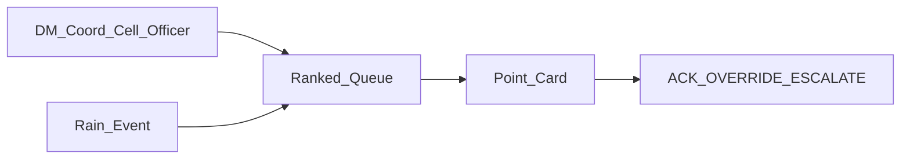

# Product Requirements Document — DisputePoint Response Intelligence

**Audience:** Anyone on the team, including a judge who reads the write-up.  
**Question:** What are we building, for whom, and how do we know it works?  
**Source of truth:** [PHASE6.md](PHASE6.md) Part II. This file is an extract of the Phase 6 freeze. If this file and Phase 6 disagree, Phase 6 wins.  
**Claims:** Keep FACT / DERIVED / ASSUMPTION labels. Do not upgrade an assumption into a fact.  
**Not in this document:** Endpoints, schema fields, weight numbers, AWS resource names, CSS tokens, component file names. See [HLD.md](HLD.md), [LLD.md](LLD.md), [UX.md](UX.md).

**Reads with:** [PHASE6.md](PHASE6.md) · [HLD.md](HLD.md) · [LLD.md](LLD.md) · [UX.md](UX.md) · [build/LICENSE_AUDIT.md](build/LICENSE_AUDIT.md)

**Join key:** This file owns each FR id, its priority, and its acceptance sentence. Other extracts name the module, test, or screen for that id.

---

## 1. Job diagram

The officer opens a ranked queue. Rain changes the order. The officer opens a point card. The officer records ACK, OVERRIDE, or ESCALATE.

---

## 2. Problem and product summary

| Field | Content | Source |
|-------|---------|--------|
| Name | DisputePoint Response Intelligence | Phase 4/5 |
| One-liner | For a DM coordination cell officer, when monsoon rain threatens multi-agency disputed waterlogging points in Delhi, determine which point needs action first, which agency should act, and why | Phase 5 §1 **FACT** |
| Primary user | District Magistrate coordination cell | Phase 5 §4 |
| Backup product | DrainWatch Priority alone | Phase 4 |
| Track | Heat and Water | Official page **FACT** |

The product is a decision tool. It is not a flood heatmap.

---

## 3. Goals

1. **Decision delta.** Replace verbal buck-passing with evidence-backed agency or UNCERTAIN, plus priority under rain (Phase 4 decision-delta test).
2. **Differentiation.** Do not ship another flood prediction or readiness map (Phase 4 Gate B — Jal-Drishti / Pravah / FloodReady).
3. **Hackathon win.** Score on Idea and Impact, AWS, Design and Usability, and Execution. Keep the demo at most 3 minutes. One feature that runs beats five that almost work (**FACT** official page).
4. **Honesty.** Keep recommendations advisory. Label synthetic data. Do not invent SCADA or a full DM-71 list (Phase 5 §23).

---

## 4. Non-goals (NEVER)

| Non-goal | Why | Source |
|----------|-----|--------|
| Citywide flood prediction | Collision with saturated map products | Gate B |
| Live PWD SCADA / pump GPS | Private; Phase 6 access is red | Phase 6 §5 |
| Invent full DM-71 geolist | Public list is missing | Phase 4 Gate A |
| Citizen complaint app | Crowded lane; wrong user | Phase 5 §24 |
| Hydraulic digital twin | Data and validation are not available | Phase 5 §8 |
| Map-first hero product | Undermines differentiation | Phase 5 §15 |
| Inter / purple SaaS landing UI | AI-slop risk on Design score | UX research |

**Allowed (not non-goals):** secondary MapLibre HUD with point markers after VERIFIED geocodes; in-screen Cmd+K point jump; judges eval link/drawer. None of these replace queue-first home ([build/DEMO_WOW.md](build/DEMO_WOW.md)).

---

## 5. Personas and jobs

| Role | Job | Authority |
|------|-----|-----------|
| **Primary: DM coord cell** | When rain hits, show disputed points that need an owner named now | DM-71 mandate (**FACT** PTI / ThePrint) |
| Secondary: PWD / MCD EE | Consume the card for owned assets | Field authority |
| Secondary: CR operator | Use the same card during a surge | Ops |
| Action: JE / crew | Execute the recommended action | Performer |
| Escalation: ACS-PWD path | Receive an UNCERTAIN pack | Phase 5 §4 |

---

## 6. Success metrics

| Metric | Target | Type |
|--------|--------|------|
| **Primary KPI: Time-to-actionable-triage** | Under 30 seconds from rain trigger to ranked queue to evidence to agency or UNCERTAIN to recommended action | Product (FR-027) |
| θ_assign / CONFLICT null correctness | Zero false assigns below 0.65; CONFLICT never auto-assigns | Tech |
| Evidence coverage | 100% of demo points have at least one cite URL | Data |
| Synthetic dominance | Hide-synthetic mode still ranks usefully | Phase 5 §0-C |
| Demo length | At most 180 seconds of script | Judging |
| Anti-slop audit | Pass the UX checklist | Design |

Secondary tech metrics (baselines, NDCG, calibration, latency) support the primary KPI. They do not replace it.

---

## 7. Functional requirements

Each block owns the id. Priority is MUST, SHOULD, or COULD. Acceptance is the pass condition.

### FR-001

- **Requirement:** The system loads at least 12 curated DisputePoints with lat/lon in the Delhi bbox.
- **Priority:** MUST
- **Acceptance:** Schema validate
- **On screen:** Yes — queue rows (see [UX.md](UX.md))

### FR-002

- **Requirement:** Each point has at least one Evidence item with url and quote.
- **Priority:** MUST
- **Acceptance:** Fixture test
- **On screen:** Yes — evidence list on the point card

### FR-003

- **Requirement:** Ownership yields ASSIGNED, CONFLICT, or UNKNOWN.
- **Priority:** MUST
- **Acceptance:** Unit test
- **On screen:** Yes — state chip

### FR-004

- **Requirement:** If confidence is under 0.65, or ownership_state is CONFLICT, set responsible_agency to null and show escalate copy.
- **Priority:** MUST
- **Acceptance:** θ test + T-OWN-CF-NULL
- **On screen:** Yes — blank agency + escalate copy

### FR-005

- **Requirement:** Priority score uses Phase 5 factors and exposes a factor breakdown that includes coordination_uncertainty U.
- **Priority:** MUST
- **Acceptance:** API field present
- **Numeric weights:** See [LLD.md](LLD.md) priority function. This PRD names the factors R, S, C, Q, U, G only.
- **On screen:** Yes — priority explain bars

### FR-006

- **Requirement:** Rain from Open-Meteo updates R and re-ranks the queue.
- **Priority:** MUST
- **Acceptance:** Live path or cache path works
- **On screen:** Yes — rain control and rank changes

### FR-007

- **Requirement:** Scenario slider rain is available when live rain fails.
- **Priority:** MUST
- **Acceptance:** Fallback banner is visible
- **On screen:** Yes — slider + `Using scenario rain`

### FR-008

- **Requirement:** Queue UI lists points by priority_rank.
- **Priority:** MUST
- **Acceptance:** E2E
- **On screen:** Yes — home is the queue

### FR-009

- **Requirement:** Point card shows agency, confidence, evidence, action, and advisory banner.
- **Priority:** MUST
- **Acceptance:** E2E
- **On screen:** Yes — detail pane

### FR-010

- **Requirement:** Show a SYNTHETIC badge when readiness.is_synthetic is true.
- **Priority:** MUST
- **Acceptance:** UI assert
- **On screen:** Yes — readiness block

### FR-011

- **Requirement:** CONFLICT shows multiple agencies. Set responsible_agency to null always. Do not silent-pick one agency.
- **Priority:** MUST
- **Acceptance:** T-OWN-CF-NULL
- **On screen:** Yes — multi-agency CONFLICT state

### FR-012

- **Requirement:** ACK, OVERRIDE, and ESCALATE with a visible audit panel (recommended vs human, reason, time).
- **Priority:** MUST
- **Acceptance:** API + UI
- **On screen:** Yes — action block + audit panel

### FR-013

- **Requirement:** hide-synthetic zeros the readiness gap weight G.
- **Priority:** SHOULD
- **Acceptance:** Unit test
- **On screen:** Yes — honesty toggle effect

### FR-014

- **Requirement:** Optional segment geometry for Purana Quila-class points.
- **Priority:** SHOULD
- **Acceptance:** Geo test
- **On screen:** Optional — not required for home nav

### FR-015

- **Requirement:** Baseline tournament vs Random, Severity, Rain, Recurrence, Nearest, Static, Weighted. No ML in the MVP. Report path `tests/eval/baseline_tournament.md` is MUST; optional UI link/drawer must not invent metrics.
- **Priority:** MUST
- **Acceptance:** Eval script; optional judges UI per [DEMO_WOW.md](build/DEMO_WOW.md) J2
- **On screen:** Optional — footer link / drawer; markdown remains SoT

### FR-016

- **Requirement:** Document an AWS Ship It path or a SAM Build It path. Show AWS in the video plan.
- **Priority:** MUST
- **Acceptance:** Eligibility check
- **Service list:** See [HLD.md](HLD.md). This PRD does not name AWS resources.
- **On screen:** No — architecture beat in the video

### FR-017

- **Requirement:** Golden Purana Quila end-to-end scenario passes.
- **Priority:** MUST
- **Acceptance:** Phase 6 §23
- **On screen:** Yes — demo path

### FR-018

- **Requirement:** Run a failure-injection suite subset.
- **Priority:** MUST
- **Acceptance:** Part I §24
- **On screen:** No

### FR-019

- **Requirement:** Provenance and license-audit fields exist on sources.
- **Priority:** MUST
- **Acceptance:** Contract test
- **On screen:** Partial — provenance footer; full table in [LICENSE_AUDIT.md](build/LICENSE_AUDIT.md)

### FR-020

- **Requirement:** Do not use map-only primary navigation. Optional secondary MapLibre HUD (BUILD IF STABLE) must not become home; queue works with map closed/absent.
- **Priority:** MUST
- **Acceptance:** UX review; [ACCEPTANCE_CRITERIA.md](quality/ACCEPTANCE_CRITERIA.md); E2E-01 / E2E-07 (HUD skippable without VERIFIED coords)
- **On screen:** Yes — home is the queue; MapHUD secondary only

### FR-021

- **Requirement:** Keyboard focus order is queue then card. Loading, empty, and error states exist.
- **Priority:** MUST
- **Acceptance:** Accessibility check
- **On screen:** Yes

### FR-022

- **Requirement:** IMD is secondary only if a key is present.
- **Priority:** COULD
- **Acceptance:** Config check
- **On screen:** No

### FR-023

- **Requirement:** Counterfactual deltas plus Why now / location / agency copy on the card.
- **Priority:** MUST
- **Acceptance:** API + UI
- **On screen:** Yes — counterfactual chips

### FR-024

- **Requirement:** Uncertainty bands HIGH, MEDIUM, UNCERTAIN. UNCERTAIN is a successful honest outcome.
- **Priority:** MUST
- **Acceptance:** Unit + UI
- **On screen:** Yes — band chip

### FR-025

- **Requirement:** LLM extraction only after schema and quote⊆source validation. Integrate in the demo only if §14A AI Gate PASS.
- **Priority:** SHOULD
- **Acceptance:** §14A
- **On screen:** No — extraction is offline or gated

### FR-026

- **Requirement:** Write a feedback dataset row on each human decision. Online learning is not required.
- **Priority:** SHOULD
- **Acceptance:** Schema
- **On screen:** Partial — audit panel is visible; dataset row is storage

### FR-027

- **Requirement:** Primary KPI time-to-actionable-triage under 30 seconds on the demo path.
- **Priority:** MUST
- **Acceptance:** Demo timing
- **On screen:** Yes — timed path

---

## 8. Non-functional requirements

Targets only. Implementation detail lives in [HLD.md](HLD.md) and [LLD.md](LLD.md).

### NFR-001

- **Requirement:** GET /points latency local
- **Target:** Under 300 ms
- **Source:** Part I §25

### NFR-002

- **Requirement:** Rank 15 points
- **Target:** Under 50 ms
- **Source:** Part I §25

### NFR-003

- **Requirement:** Offline shell plus fixtures
- **Target:** Works without network
- **Source:** Part I §16

### NFR-004

- **Requirement:** Secrets never in git
- **Target:** .gitignore plus scan
- **Source:** Part I §28

### NFR-005

- **Requirement:** Free Tier cost
- **Target:** Within $200 credits
- **Source:** Official Free Tier

### NFR-006

- **Requirement:** Structured logs with request_id
- **Target:** Always
- **Source:** Part I §26

### NFR-007

- **Requirement:** Contrast and focus visible; mobile and tablet readable fallback
- **Target:** WCAG-ish AA intent
- **Source:** Gov UX

### NFR-008

- **Requirement:** UI anti-slop
- **Target:** Pass [UX.md](UX.md) checklist
- **Source:** UX research

### NFR-009

- **Requirement:** Clean-room clone install, test, and run
- **Target:** Phase 6 §41 pass
- **Source:** Reproducibility

### NFR-010

- **Requirement:** License audit complete before submit
- **Target:** All assets allowed_for_demo
- **Source:** [LICENSE_AUDIT.md](build/LICENSE_AUDIT.md)

---

## 9. User stories (Given / When / Then)

### US-01 Queue triage

Given fixtures loaded, When the officer opens the app, Then the ranked queue shows name, rank index, ownership_state, and priority_score within 10 seconds without opening a map.

### US-02 Evidence why

Given point `dp-purana-quila`, When the card opens, Then evidence quotes and source URLs explain agency or CONFLICT (Phase 4 Gate A row 1 — six jurisdictions **FACT**).

### US-03 Rain re-rank

Given dry baseline ranks, When rain is at or above threshold via API or slider, Then top-k changes and explanation chips show R contribution increase.

### US-04 Uncertain escalate

Given confidence under 0.65, When the card renders, Then responsible_agency is empty and copy says escalate to the coordination cell. Do not guess an agency.

### US-05 Advisory trust

Given any ASSIGNED recommendation, When the banner is visible, Then the text states the recommendation is advisory, not an official assignment (Phase 5 §23).

### US-06 Synthetic honesty

Given readiness fixture is_synthetic=true, When hide-synthetic is off, Then the badge is shown. When hide-synthetic is on, Then G weight is 0.

### US-07 HITL

Given an OPEN point with a recommendation, When the officer ACK or OVERRIDE (with reason) or ESCALATE, Then the audit stores recommended vs final agency, reviewer, and timestamp.

### US-08 Counterfactual

Given a top-ranked point, When the card shows Why now / location / agency, Then each chip maps to a measured Δpriority from a single-factor perturbation.

### US-09 Uncertain success

Given confidence under 0.65, When rendered, Then the UNCERTAIN band is shown as a successful honest outcome. It is not an error.

---

## 10. Data honesty and trust policy

1. Recommendations are advisory.
2. `is_synthetic` and `is_derived` must survive to the UI.
3. Never invent coordinates or pump telemetry (**FACT** Phase 6 red sources).
4. COURT_ORDER evidence weights highest. SPATIAL_HEURISTIC weights lowest (Phase 5 §12).
5. Prefer CONFLICT over a wrong single owner.
6. Every external asset passes the license gate before submission (Phase 6 §37). See [LICENSE_AUDIT.md](build/LICENSE_AUDIT.md).
7. LLM claims require quote⊆source validation before Evidence weight.

---

## 11. Demo beats (what must be on screen)

Minute-by-minute beat sheet stays in Phase 6 §39. This product must make these beats visible:

1. Queue ranks.
2. Rain re-rank.
3. Purana Quila evidence or CONFLICT.
4. Advisory action.
5. ACK or OVERRIDE.
6. AWS on screen in the video.

**Wow:** Citations name an agency while a prediction map would not (Phase 5 §16). Counterfactuals answer why the officer should believe this.

---

## 12. Open questions (status)

Do not invent beyond this table. Details: [build/DATA_PLAYBOOK.md](build/DATA_PLAYBOOK.md), [LLD.md](LLD.md) § Implementation locks, [build/GAPS.md](build/GAPS.md).

| # | Question | Status | Lock |
|---|----------|--------|------|
| 1 | Final 12–15 point ID list | LOCKED | Gate A #1–#14 in fixtures v0.2; Data Ready PASS. Residual: COURT `needs_review`; geo CANDIDATE / null_accept |
| 2 | θ_assign calibration | LOCKED | Freeze **0.65** until fixture gold; §12B may recalibrate later |
| 3 | `@carbon/react` vs CSS-var | LOCKED | CSS variables + React only |
| 4 | Ship It vs Build It | LOCKED | Prefer Ship It; day-1 recon may choose Build It if account/SAM blocked |
| 5 | Bedrock extraction | LOCKED | Off for MVP; fixtures-only evidence |
| 6 | ML runtime | LOCKED | Phase 6 gate = no KEEP for MVP |

---

## 13. Conflict rule (product)

If ownership_state is CONFLICT, set responsible_agency to null. Always. Do not auto-pick an agency when the top score is at or above θ.

Same rule appears in [HLD.md](HLD.md) degradation, [LLD.md](LLD.md) invariants, and [UX.md](UX.md) CONFLICT state.

---

## 14. Glossary (term lock)

| Term | Meaning | Do not say |
|------|---------|------------|
| officer | DM coordination cell primary user | user, operator (except CR operator role) |
| point | A curated DisputePoint | hotspot (except when quoting press), flood cell |
| responsible_agency | Agency named when ASSIGNED; else null | owner (alone), winner |
| ownership_state | ASSIGNED, CONFLICT, or UNKNOWN | status (status is OPEN/ACKED/RESOLVED) |
| coordination uncertainty (U) | Response bottleneck from unresolved or conflicting responsibility | flood severity, physical risk |
| advisory | Recommendation is not an official government assignment | mandate, order |
| SYNTHETIC | Fixture or derived readiness not from live SCADA | real pump telemetry |

---

## 15. Problem context (why this product)

**FACT (track):** Environmental Hacks Heat and Water covers monsoon waterlogging ([wemakedevs.org/aws/env](https://www.wemakedevs.org/aws/env)).

**FACT (mandate):** Delhi directed District Magistrates on about 71 waterlogging points where agencies refuse or split ownership (Phase 4 Gate A; PTI / ThePrint).

**FACT (collision):** Student and civic products already ship flood prediction and readiness maps (Jal-Drishti, Pravah, FloodReady class). Gate B rejects another map-first product.

**DERIVED:** The decision gap is not “where will water go.” The gap is “who acts first, with what evidence, when rain rises.”

**ASSUMPTION:** A DM cell officer can triage from a ranked queue in under 30 seconds if evidence and agency or UNCERTAIN sit on one card.

---

## 16. Golden scenario (product acceptance narrative)

This is the product story for FR-017. Implementation sequence lives in [LLD.md](LLD.md).

1. Fixtures load at least 12 points. Purana Quila is among them.
2. Dry baseline shows a ranked queue. Map is not required.
3. Officer applies rain at or above threshold (live, cache, or slider).
4. Purana Quila rank rises or stays high for an explainable reason. Factor chips show R and U contributions.
5. Card opens. Evidence quotes and URLs show multi-agency claims (**FACT:** Phase 4 cites six jurisdictions on this corridor class).
6. ownership_state is CONFLICT or ASSIGNED with confidence. If CONFLICT, responsible_agency is null. Escalate copy is visible.
7. Advisory banner is visible on any recommendation.
8. Officer ACK, OVERRIDE with reason, or ESCALATE. Audit shows recommended vs human decision.
9. Time from rain trigger to actionable card content is under 30 seconds on the demo path (FR-027).

Fail if the UI only shows “high flood risk” without agency or UNCERTAIN. Fail if CONFLICT invents a single agency.

---

## 17. MVP scope vs later

### In MVP (MUST / SHOULD as in §7)

- Curated 12–15 points with evidence
- Deterministic ownership + θ
- Explainable weighted priority + counterfactual chips
- Rain live → cache → slider
- Queue + point card + HITL audit
- Baseline tournament script (no ML)
- AWS Ship It or SAM Build It path documented
- Honesty badges and license fields

### Out of MVP (NEVER or open gate)

- Predictive flood ML runtime (gate = no KEEP)
- Live SCADA / pump GPS
- Cognito multi-user auth
- Map-first home
- Invented DM-71 full list
- Online learning from HITL (feedback rows yes; training no)

---

## 18. FR failure modes (what breaks if missing)

| FR | If missing, the product fails because… |
|----|----------------------------------------|
| FR-001 | No corpus to triage |
| FR-002 | Agency claims have no proof |
| FR-003–004 / FR-011 | Officer gets a silent wrong agency |
| FR-005 / FR-023 | Rank looks arbitrary; no Why chips |
| FR-006–007 | Demo dies when Open-Meteo fails |
| FR-008–009 / FR-020 | Product collapses to a map or blank shell |
| FR-010 / FR-013 | Synthetic readiness looks like SCADA |
| FR-012 | Government-facing decision has no human trail |
| FR-015 | Cannot answer “beats a dumb heuristic?” |
| FR-016 | Prize eligibility fails |
| FR-017 / FR-027 | Demo story and KPI fail |
| FR-019 / NFR-010 | Submission compliance fails |
| FR-021 / NFR-007–008 | Design and usability score fails |
| FR-024 / US-09 | Honest UNCERTAIN looks like a bug |
| FR-025 | LLM path could silently invent ownership |
| FR-026 | No future labels for Amazon-engineer signal |

---

## 19. Traceability: story → FR → demo beat

| Story | Primary FRs | Demo beat |
|-------|-------------|-----------|
| US-01 | FR-008, FR-020 | Queue ranks |
| US-02 | FR-002, FR-009, FR-017 | Purana Quila evidence |
| US-03 | FR-006, FR-007, FR-005 | Rain re-rank |
| US-04 / US-09 | FR-004, FR-024 | UNCERTAIN escalate |
| US-05 | FR-009 honesty | Advisory action |
| US-06 | FR-010, FR-013 | Synthetic badge / hide |
| US-07 | FR-012, FR-026 | ACK / OVERRIDE |
| US-08 | FR-023 | Counterfactual chips |
| Eligibility | FR-016 | AWS on screen |

---

## 20. Constraints (product-visible)

| Constraint | Source |
|------------|--------|
| New code after hackathon clock; planning before clock is allowed | Tour rules |
| Demo video ≤3 min; no live demo | Official page **FACT** |
| AWS must appear in the video | Tour rules **FACT** |
| List AI coding tools (Cursor) in write-up | Tour rules |
| Free Tier within about $200 credits | Official |
| Teams 1–4; Heat and Water track | Official |

---

## 21. Definition of done (product)

- All MUST FRs have a green acceptance path.
- Golden Purana Quila narrative in §16 passes.
- Anti-slop checklist in [UX.md](UX.md) passes.
- License audit allows demo assets ([LICENSE_AUDIT.md](build/LICENSE_AUDIT.md)).
- Judge-blind packet works with only repo, URL or Build It recording, video, and write-up (Phase 6 §38).
