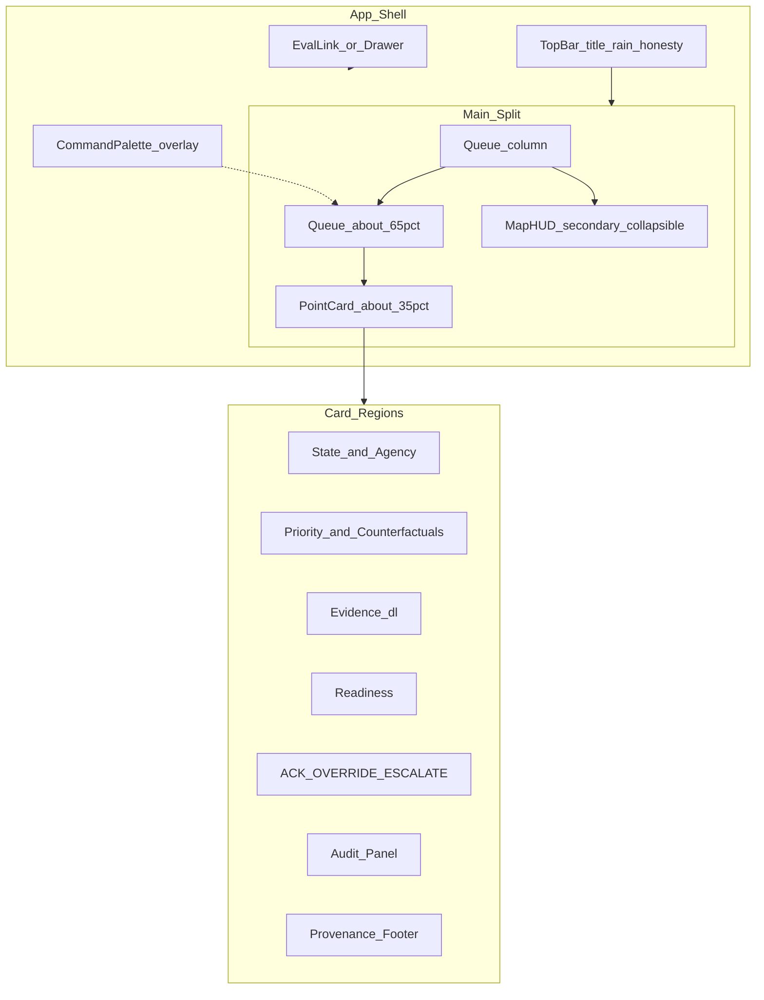

# UI / UX Spec — DisputePoint Response Intelligence

**Audience:** Whoever builds or reviews the screen.  
**Question:** What does the officer see, in every state that can happen?  
**Source of truth:** [PHASE6.md](PHASE6.md) Part II-B. This file is an extract of the Phase 6 freeze. If this file and Phase 6 disagree, Phase 6 wins.  
**Claims:** Keep FACT / DERIVED / ASSUMPTION labels. Do not upgrade an assumption into a fact.  
**Not in this document:** HTTP paths, database keys, the priority formula. See [LLD.md](LLD.md) and [HLD.md](HLD.md).

**Reads with:** [PHASE6.md](PHASE6.md) · [PRD.md](PRD.md) · [HLD.md](HLD.md) · [LLD.md](LLD.md) · [research/ux-anti-slop-research.md](research/ux-anti-slop-research.md)

**Join key:** Screen states for FR ids that are officer-visible. Component file names live only in [LLD.md](LLD.md).

### V2 IA reopen note (2026-10-09)

Progressive multi-screen IA is allowed for V2: Command queue + map, Incident (slim), Case Evidence, Coordination (human review), Audit (DecisionRecord), Demo Signature Interaction. Wireframe gate: [build/WIREFRAMES_V2.md](build/WIREFRAMES_V2.md). Labels: RESPONSIBILITY DISPUTED · AWAITING YOU · OFFICER CONFIRMED. Phase 6 hard stops unchanged (CONFLICT ⇒ null agency until human confirm).

**Research:** [research/ux-anti-slop-research.md](research/ux-anti-slop-research.md)  
**Citations:** [Sailop 73 patterns](https://sailop.com/blog/from-ai-slop-to-signature-73-patterns-2026); [avoid-ai-design](https://github.com/funboy322/avoid-ai-design); [Carbon type](https://www.carbondesignsystem.com/building-blocks/foundations/typography/type-sets); OpenELIS Carbon adoption.

---

## 1. Screen diagram



Demo wow IDs and Phase 7 add-on rules: [build/DEMO_WOW.md](build/DEMO_WOW.md).

---

## 2. Design thesis

DisputePoint is a monsoon coordination workbench. Keep it dense, typographic, and evidence-forward. It must look like an operator tool. It must not look like a YC landing page.

Treat density as **mission-control / decision-support** (ops triage), not as a SaaS marketing dashboard. Stay on the **one-screen ~65% queue / ~35% point-card** split in §1–§3. Do not redesign into a multi-page admin app, a chat surface, a generative canvas, or a dark three-pane SOC template (`slate-950`, emoji headers). Any map is a **secondary HUD only** — home must work without it (FR-020). Frontend stack rejects and library guidance: [design/DESIGN_SYSTEM.md](design/DESIGN_SYSTEM.md).

---

## 3. Information architecture

One screen. Not a multi-page marketing site.

- Top bar: title, rain control, honesty mode toggle.
- Main split: about 65% queue, about 35% detail.
- Home is the queue. No map is required to see rank, name, state, agency, and score (US-01, FR-020).
- **MapHUD (BUILD IF STABLE):** collapsible secondary strip under the queue or card inset — point markers only after VERIFIED geocodes; never primary nav; home works with map closed/absent.
- **CommandPalette (J1):** ⌘K / Ctrl+K fuzzy-jumps to a point (`selectedPointId` same as row click). Not a multi-page SaaS shell.
- **Eval aid (J2):** footer link “Judges: baseline tournament” to [tests/eval/baseline_tournament.md](../tests/eval/baseline_tournament.md), and/or optional drawer / `?panel=eval`. Link-out is enough while metrics are TBD. Never invent Spearman/top-k for the UI.

---

## 4. Queue

Sticky header table. Columns in order:

1. Rank
2. Name
3. State
4. Agency
5. Priority
6. Rain delta

Rank is mono text such as `[01]`.

---

## 5. Point card regions

Top to bottom:

1. State and agency
2. Priority explanation and counterfactual chips
3. Evidence as a definition list (`dl` / `dt` / `dd`)
4. Readiness
5. Recommended action
6. ACK / OVERRIDE / ESCALATE
7. Audit panel
8. Provenance footer

OVERRIDE needs agency, reason, and confirm. ESCALATE needs a reason. Audit panel shows system recommendation versus human decision, reason, and time.

---

## 6. Primary flow

1. Open the queue.
2. Change rain.
3. See rows move.
4. Open Purana Quila.
5. Read cites.
6. See the advisory banner.
7. Record ACK, OVERRIDE, or ESCALATE.
8. See the audit line change.

---

## 7. Screen states

Each state lists what is on screen, what the officer can do, and the copy when Phase 6 fixed a string.

### 7.1 Empty fixtures

- **On screen:** Empty queue message.
- **Officer can:** Check fixtures and reload.
- **Copy:** `No disputed points loaded. Check fixtures.`
- **FR:** FR-021

### 7.2 Loading

- **On screen:** Non-blank loading state on queue or card. Not a white void.
- **Officer can:** Wait. Focus remains visible.
- **FR:** FR-021

### 7.3 API error

- **On screen:** Error toast or inline error. Queue shell remains.
- **Officer can:** Retry or use local fixtures if the shell is offline.
- **FR:** FR-021, NFR-003

### 7.4 ASSIGNED with advisory

- **On screen:** Single responsible_agency, confidence, advisory banner, evidence, action.
- **Officer can:** ACK, OVERRIDE, or ESCALATE.
- **Copy:** `Advisory only — not an official agency assignment.`
- **FR:** FR-009, FR-012, US-05

### 7.5 CONFLICT

- **On screen:** Multiple agencies. Blank responsible_agency. Escalate language. Evidence cites.
- **Officer can:** ESCALATE or OVERRIDE with an explicit human choice. The system does not pick one agency. ACK is disabled.
- **Rule:** If ownership_state is CONFLICT, responsible_agency is null. Always.
- **FR:** FR-004, FR-011

### 7.6 UNKNOWN

- **On screen:** Empty responsible_agency. Escalate copy.
- **Officer can:** OVERRIDE or ESCALATE (ACK disabled).
- **Copy:** `Ownership uncertain — escalate to coordination cell.`
- **FR:** FR-004, US-04

### 7.7 UNCERTAIN band

- **On screen:** UNCERTAIN band chip as a successful honest outcome.
- **Officer can:** Treat it as valid triage, not as a crash.
- **FR:** FR-024, US-09

### 7.8 Synthetic badge on

- **On screen:** SYNTHETIC badge on readiness when `is_synthetic` is true and hide-synthetic is off.
- **Copy:** `Readiness: synthetic fixture (not live SCADA).`
- **FR:** FR-010, US-06

### 7.9 Hide-synthetic on

- **On screen:** Honesty toggle on. Synthetic badge path off for scoring. Readiness weight G is zero in ranking.
- **Officer can:** Compare ranks without synthetic readiness dominance.
- **FR:** FR-013, US-06

### 7.10 Rain live

- **On screen:** Precip readout from live source. Mode shows live.
- **Officer can:** Trigger refresh.
- **FR:** FR-006

### 7.11 Rain cached

- **On screen:** Cached precip. Honesty about cache mode.
- **Officer can:** Switch to slider if needed.
- **FR:** FR-006, FR-007

### 7.12 Rain slider

- **On screen:** Scenario slider. Banner that the rain is a scenario.
- **Copy cue:** `Using scenario rain`
- **FR:** FR-007

### 7.13 Audit empty

- **On screen:** Audit panel with no human decision yet. System recommendation visible.
- **Officer can:** ACK, OVERRIDE, or ESCALATE.
- **FR:** FR-012

### 7.14 Audit filled

- **On screen:** SYSTEM RECOMMENDED line and HUMAN DECISION line with agency, reason, and time.
- **Officer can:** Read the trail. Further actions follow status rules.
- **FR:** FR-012, FR-026, US-07

### 7.15 MapHUD — no verified coords / collapsed

- **On screen:** MapHUD unmounted or `height: 0` until expanded; no empty gray strip. Queue + card unchanged.
- **Officer can:** Triage fully without a map (FR-020). Toggle control (when present) has `aria-label` e.g. `Show map` / `Hide map`.
- **FR:** FR-020; unlock markers only after GAP-DATA-04 VERIFIED promote ([DEMO_WOW.md](build/DEMO_WOW.md) M1).

### 7.16 CommandPalette open

- **On screen:** Overlay dialog; fuzzy list of queue points. Trigger control has accessible name (e.g. `Jump to point`).
- **Officer can:** Select point → same as row click; **Esc** closes and returns focus to the prior control.
- **Not:** Billing, Settings, or route changes off the one-screen shell.

### 7.17 Eval aid open

- **On screen:** Footer link and/or read-only drawer with tournament table (TBD cells OK) or markdown view. Drawer has close control + **Esc** dismiss.
- **Officer / judges can:** Inspect baselines vs gold when filled; otherwise follow link to report skeleton.
- **Forbidden:** Invented metrics. FR-015 MUST remains the markdown report.

### Requirements not on screen

These FR ids have no primary officer UX state (eval UI is judges-optional). Acceptance stays in [PRD.md](PRD.md):

- FR-015 (baseline tournament report — markdown MUST; UI optional)
- FR-016 (AWS path documentation)
- FR-018 (failure-injection suite)
- FR-022 (IMD secondary config)
- FR-025 (LLM extraction gate)

---

## 8. Visual system

### Typography

| Role | Face | Size / weight | Use |
|------|------|---------------|-----|
| UI body | IBM Plex Sans | 14px / 400 | Queue cells |
| Section | IBM Plex Sans | 16–20px / 600 | Card titles |
| Meta / scores | IBM Plex Mono | 13–14px / 500 tabular | priority_score, confidence |
| Rank index | IBM Plex Mono | 12px / 600 | `[01]` |

Fonts: `@fontsource/ibm-plex-sans`, `@fontsource/ibm-plex-mono`.

### Color tokens

| Token | Hex | Role |
|-------|-----|------|
| `--dp-bg` | `#f5f6f8` | App background |
| `--dp-surface` | `#ffffff` | Cards / tables |
| `--dp-text` | `#161616` | Primary text |
| `--dp-text-2` | `#525252` | Secondary |
| `--dp-ink` | `#1c2541` | Actions / links |
| `--dp-border` | `#e0e0e0` | Rules |
| `--dp-warn` | `#b28600` | CONFLICT / UNCERTAIN |
| `--dp-danger` | `#a2191f` | Underpass severity |
| `--dp-ok` | `#198038` | ACKED / OK readiness |
| `--dp-synthetic` | `#8a3ffc` | Badge only |

### Layout chrome

- Radius: `0` or `2px`
- Border: 1px `--dp-border`
- Elevation: one subtle shadow max on the detail panel
- No marketing cards in the detail pane

### Motion (max 2 UI effects)

1. Priority rank change: 200 ms background flash on moved rows.
2. Rain control active: small pulse on precip readout.

MapHUD `flyTo` is **camera movement**, not a third UI motion — it does not burn this budget ([DEMO_WOW.md](build/DEMO_WOW.md) C3).

**Reduced motion:** honor `prefers-reduced-motion: reduce` — disable rank flash and rain pulse (instant state change OK); MapHUD uses jump / `duration: 0` instead of animated `flyTo`.

No page parallax. No skeleton shimmer rainbow.

---

## 9. Required copy

Exact strings. Do not rewrite.

- `Advisory only — not an official agency assignment.`
- `Ownership uncertain — escalate to coordination cell.`
- `Readiness: synthetic fixture (not live SCADA).`
- `No disputed points loaded. Check fixtures.`

---

## 10. Banned (fail Design review if present)

| Ban | Source |
|-----|--------|
| Inter, Geist, Roboto, Arial-only, system-ui-only stacks | Sailop #1; avoid-ai-design |
| Purple / indigo / pink gradients; Tailwind blue-500 / 600 CTAs | Sailop #14 |
| Centered hero + three feature cards as home | Sailop #23–24; Phase 5 §15 |
| `rounded-2xl` + heavy shadow + glass / blur chrome | avoid-ai-design |
| Glow pills, emoji icon rows, dark neon default | Project frontend rules |
| Copy: AI-powered, seamless, elevate, smart city, end-to-end platform | stop-slop + Phase 5 §1 bans |

---

## 11. Accessibility

**SoT for a11y rules.** [design/DESIGN_SYSTEM.md](design/DESIGN_SYSTEM.md) repeats a short extract only.

- **Skip link:** first focusable control “Skip to queue” (or skip to main) before the top bar chrome.
- **Focus:** order queue then card (FR-021); visible 2px focus ring using `--dp-ink`. Do not remove outline without a replacement ring.
- **Touch:** interactive **controls** (ACK / OVERRIDE / ESCALATE, rain, honesty toggle, MapHUD toggle, palette trigger) ≥ **44×44px** with ≥8px gap. Queue **rows may be ~40px** if the full row is the hit target.
- **Color + text:** State, severity, and SYNTHETIC always show a text label (or chip text) — never color alone.
- **Contrast (NFR-007):** verify `--dp-text`, `--dp-text-2`, `--dp-warn`, and `--dp-synthetic` (badge) on `--dp-surface` / `--dp-bg` meet ~4.5:1. Use browser DevTools; axe is recommended, not a gate.
- **Aria:** `aria-label` (or visible text) on MapHUD toggle, CommandPalette trigger, and any icon-only Lucide control.
- **HITL busy:** while ACK/OVERRIDE/ESCALATE request is in flight, disable confirm, set `aria-busy` on the action region; show error **near the form** on failure (not only a top toast).
- **Overlays:** Esc closes CommandPalette and EvalDrawer; focus returns to the opener.
- **Body type:** 14px is intentional for dense ops; contrast still required.
- Narrow viewport: same product, readable queue. Do not invent a different product.

---

## 12. Pre-demo anti-slop checklist

Run together with **§23 Visual QA** before the demo video (`T-VIS-AUDIT`).

- [ ] No Inter / Geist in computed styles
- [ ] No purple / blue gradient backgrounds
- [ ] Home is queue, not hero
- [ ] Tabular mono on numeric scores
- [ ] Advisory + SYNTHETIC badges visible when applicable
- [ ] At most 2 UI motion effects; `prefers-reduced-motion` honored
- [ ] No “AI-powered” in UI strings
- [ ] Contrast OK on text / text-2 / warn / synthetic on surface
- [ ] Skip link + keyboard queue → card works
- [ ] HITL / rain / toggles ≥44×44; color+text on state chips
- [ ] HITL shows busy/disabled during submit; error near form
- [ ] Loading / empty / error states exist (not blank white)
- [ ] Mobile / tablet: queue readable without horizontal chaos
- [ ] Counterfactual / uncertainty chips readable

---

## 13. Tooling note

Implement with CSS variables plus React. Use `@carbon/react` only if the implementer writes down why. Rank text comes first. Carbon icons are secondary. A one-frame wire in Excalidraw or Penpot is a Phase 7 step. This file does not include a Figma file.

---

## 14. Wireframe (text)

```text
┌──────────────────────────────────────────────────────────────────────────┐
│ DisputePoint   [Rain ▓▓▓ 40mm ▾] [Live|Cache|Slider] [Hide synth]  ⌘K   │
├────────────────────────────────────────────┬─────────────────────────────┤
│ Rank  Name              State     Agency   │ ADVISORY BANNER (global)    │
│ [01]  Purana Quila…     CONFLICT  —        │ State: CONFLICT             │
│ [02]  Minto Bridge      ASSIGNED  PWD      │ Agency: (null)              │
│ [03]  Barapullah        UNKNOWN   —        │ … card regions …            │
│ …                                          │ Provenance footer           │
│ [MapHUD ▾ ~220px collapsible — BUILD IF    │                             │
│  STABLE; markers only if VERIFIED coords]  │                             │
├────────────────────────────────────────────┴─────────────────────────────┤
│ Judges: baseline tournament (link) · optional EvalDrawer                 │
└──────────────────────────────────────────────────────────────────────────┘
     ~65% queue                               ~35% card
```

Home is this shell. Do not place a hero, three feature cards, or a full-bleed map above the queue. MapHUD stays secondary and may be absent.

---

## 15. Queue column spec

| Column | Content | Typeface | Notes |
|--------|---------|----------|-------|
| Rank | `[01]` zero-padded | Plex Mono 12/600 | Sticky with header |
| Name | Point display name | Plex Sans 14/400 | Truncate with title tooltip |
| State | ASSIGNED / CONFLICT / UNKNOWN | Chip; warn color for CONFLICT / UNCERTAIN | |
| Agency | responsible_agency or em dash | Plex Sans | Em dash when null |
| Priority | score 0.00–1.00 | Plex Mono tabular | |
| RainΔ | `previous_priority_rank - current_priority_rank` (signed; positive = rose) | Plex Mono | Flash row 200 ms on change |

Row click or Enter selects the point. Selected row uses `--dp-ink` left rule, not a purple glow.

---

## 16. Card region spec

| Region | Contents | Interaction |
|--------|----------|-------------|
| State / agency | Chip + agency or null + confidence + band | MEDIUM band: text color `--dp-warn`, label `MEDIUM`, next to confidence |
| Priority explain | Component bars R S C Q U G + counterfactual chips | Chips show Δ on hover/focus |
| Evidence | `dl` of type, quote, URL | URL opens new tab; quote selectable |
| Readiness | state OK/GAP/UNKNOWN + SYNTHETIC badge | Badge only if is_synthetic and hide-synth off |
| Action | ACK / OVERRIDE / ESCALATE | See §17 |
| Audit | SYSTEM RECOMMENDED vs HUMAN DECISION | Updates after action |
| Provenance | source, retrieved_at, is_synthetic, is_derived | Read-only |

---

## 17. HITL forms (officer-visible)

**Action gate (MVP):** ACK only when `ownership_state == ASSIGNED` and status is OPEN. CONFLICT and UNKNOWN: OVERRIDE and ESCALATE only (ACK disabled). OVERRIDE only from OPEN. RESOLVED deferred.

### ACK

- Control: primary button ACK (≥44×44)
- Enable: only ASSIGNED + OPEN
- Confirm: optional one-step confirm
- Pending: disable control + `aria-busy` until response; inline error on failure
- Result: status ACKED; audit line filled

### OVERRIDE

- Controls: agency selector (allowlist), reason text (required), confirm (≥44×44)
- Enable: OPEN for ASSIGNED / CONFLICT / UNKNOWN
- Disable confirm while reason empty **or** request in flight
- Pending: `aria-busy` on action region; error near reason/confirm on failure
- Result: audit shows recommended_agency vs human_selected_agency

### ESCALATE

- Controls: reason text (required), confirm (≥44×44)
- Pending: same busy/disable + inline error pattern as OVERRIDE
- Result: escalate trail; responsible_agency remains null if CONFLICT / UNKNOWN

Do not hide OVERRIDE or ESCALATE behind a “more” menu on the demo card.

---

## 18. Copy catalog

### Fixed strings (exact)

- `Advisory only — not an official agency assignment.`
- `Ownership uncertain — escalate to coordination cell.`
- `Readiness: synthetic fixture (not live SCADA).`
- `No disputed points loaded. Check fixtures.`
- `Using scenario rain`

### Counterfactual chip stems (Phase 6 §12A)

- Why now? Rain and/or coordination uncertainty increased triage urgency by +X%.
- Why this location? Chronic flooding + unresolved agency responsibility.
- Why this agency? N supporting, M conflicting; advisory only. CONFLICT → no agency name.

### Banned words in UI

AI-powered, seamless, elevate, smart city, end-to-end platform, “more flood risk” as the sole explanation for U.

---

## 19. Focus order

1. Skip link → queue (required when chrome precedes the table)
2. Rain control
3. Honesty toggle
4. Queue rows top to bottom
5. Card regions top to bottom
6. ACK → OVERRIDE → ESCALATE
7. Evidence links
8. ⌘K / Ctrl+K opens CommandPalette (Esc returns focus to prior control)
9. MapHUD toggle (if present) after queue; map itself is not required for triage
10. Footer eval link (judges); EvalDrawer Esc/close returns focus to the link

Visible 2px focus ring on `--dp-ink`. Do not remove outline without a replacement ring.

---

## 20. Responsive behavior

| Width | Behavior |
|-------|----------|
| ≥1100px | 65/35 split side by side |
| &lt;1100px | Stack: queue on top, card below; queue remains primary; HITL/rain controls still ≥44×44 |
| Narrow phone | Same stack; horizontal scroll on queue is a last resort; prefer column priority Rank, Name, State, Priority |

When MapHUD is expanded, it sits full-width under the queue (or full-width in the stack). Collapsed = unmounted / zero height — no reserved empty strip. Do not ship a separate map-only mobile app.

---

## 21. State × visible elements matrix

| State | Agency cell | Banner | Badge | Actions enabled |
|-------|-------------|--------|-------|-----------------|
| Empty | — | — | — | Reload only |
| Loading | — | — | — | None |
| API error | — | error toast | — | Retry |
| ASSIGNED | agency name | advisory | if synth | ACK / OVERRIDE / ESCALATE (ACK only if OPEN) |
| CONFLICT | em dash | advisory + escalate | if synth | OVERRIDE / ESCALATE only (ACK disabled) |
| UNKNOWN | em dash | escalate copy | if synth | OVERRIDE / ESCALATE only (ACK disabled) |
| Hide-synth on | as state | as state | synth badge off | as state |
| Slider rain | as state | scenario rain | as state | as state |
| Audit filled | as state | as state | as state | per status |

---

## 22. Density and chrome

- Table row height ~40px OK (full-row hit target); primary buttons/controls ≥44×44
- Card section gaps 12–16px (`--dp-space` 4/8/12/16)
- No glassmorphism
- No `rounded-2xl`
- One shadow max on the detail panel
- Synthetic purple (`#8a3ffc`) on badges only — never as page gradient

---

## 23. Visual QA procedure (8 frames)

**SoT for how we visually verify.** Pair with §12. Mapped as `T-VIS-AUDIT` in [quality/TEST_STRATEGY.md](quality/TEST_STRATEGY.md). **Manual** until the frontend exists. E2E-01…09 check behavior, not pixels.

| Frame | Check |
|-------|--------|
| F1 | Cold queue ≥1100px — ranked rows, Plex, no hero/map-first |
| F2 | Stacked &lt;1100px — readable queue, no horizontal chaos; controls ≥44px |
| F3 | Keyboard: skip link → row → card → HITL |
| F4 | Purana Quila CONFLICT + null agency + evidence quotes |
| F5 | Rain slider / `Using scenario rain` + rank flash (or instant change if reduced-motion) |
| F6 | HITL busy then DecisionAuditPanel filled |
| F7 | Cmd+K open / Esc (skip if not shipped) |
| F8 | MapHUD collapsed without coords, **or** one expand if VERIFIED — never home |

**Pass:** human walk + all §12 boxes. Optional screenshots under `runs/` (gitignored) — not required. Record date, who, pass/fail in demo notes. Do not invent eval metrics for F7/F8 polish.

**Phase 7 SHOULD (later, not this docs pass):** Playwright golden frames for F1, F4, F5, F6, and wet re-rank — not Percy/Chromatic required for MVP.
